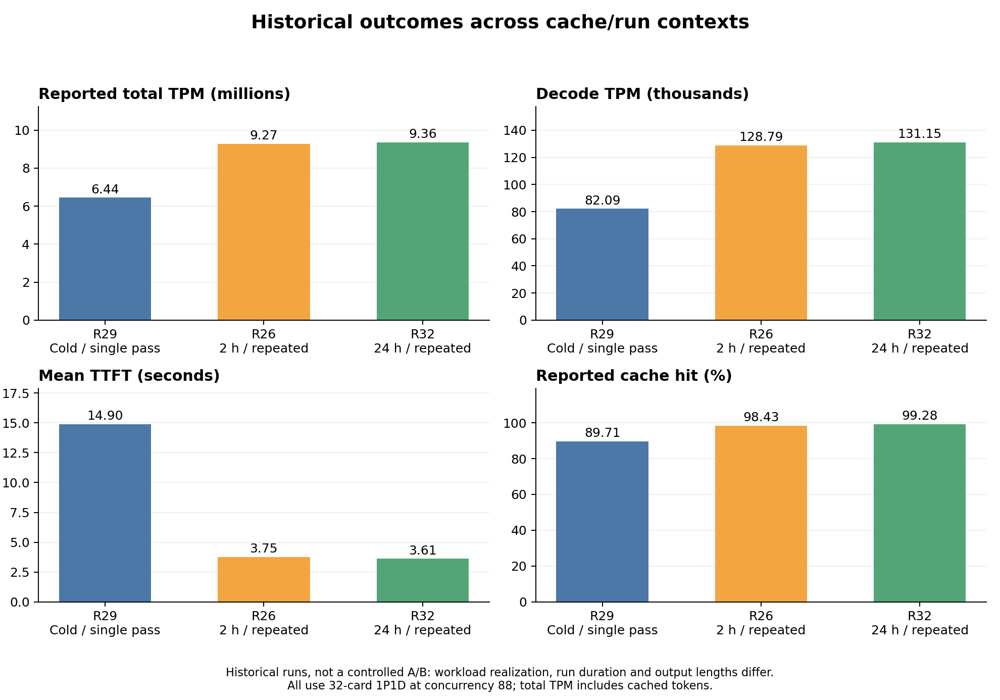
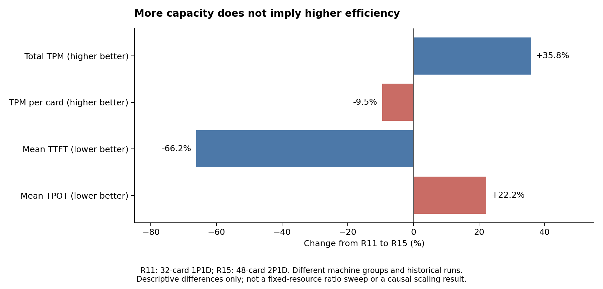

# 已有实验对论文的价值与证据审查

分析日期：2026-10-18。数据来源为 `experiments/dsv4pro_32card_pd_ratio_scan.csv`、`article/` 中的规划与阅读材料，以及随项目提供的参考论文原文。本文只解析历史记录，没有运行新实验；没有访问 CSV 所指向的 TIONE 原始日志。

**判断：有明显帮助。最值得保留的主线是“状态变化下的诊断技能复用与自动调优”，而非单独的配比扫描。已有记录能够提供真实问题、初步观测、工程链路和待验证技能，但还不能证明所提 Agent 的搜索优势。**

文中的 R1–R35 指 CSV 表头之后、从 1 开始编号的数据行。所有百分比变化均为历史观测值之比，不是控制其他条件后的因果效应，也没有统计显著性含义。原 CSV 和只读 `article/` 素材均保持不变。

## 1. 数据实际覆盖了什么

| 项目 | 解析结果 | 论文含义 |
|---|---|---|
| 记录 | 35 条；单一模型标签 `dsv4pro`、单一测试集文件名 | 是探索性实验台账，不能当作 35 次独立同条件重复 |
| 配比 | 34 条 1P1D，1 条 2P1D | 没有完整配比扫描，也不能证明配比曲线存在非单调拐点 |
| 资源 | 34 条 32 卡，R15 为 48 卡 | 文件名中的“32card”不覆盖全部实际资源点 |
| 服务模式 | 35 条均标注“PD分离” | 没有同置基线；导入说明提到同置，不等于 CSV 实际含有同置数据 |
| 正吞吐 | 23 条总 TPM 大于零 | 包含失败/降级轮，不能全部作为成功配置 |
| 零 TPM | 12 条，含部署阻塞、失败和仅记录缓存的运行 | 零值不能统一解释为实测吞吐为零，更不能解释为零时延 |
| 版本 | “镜像”“分支”各 35/35 条为空 | 备注中的“旧组”“fix 镜像”还不足以复现版本与补丁状态 |
| 指标 | 均值、缓存命中率、TPM、并发等 | 缺请求级尾时延、联合 SLO、统一预算与搜索过程记录 |

按备注作描述性标记：14 条报告失败/降级，1 条部署受阻，2 条存在部分失败，2 条只有缓存探测摘要，10 条明确写了 100% 成功，6 条未给出明确成功比例。该分类是阅读辅助，不是已审计的故障真值。

已检查两项算术关系：`总TPM ≈ TPM：P + TPM:D`，最大差约 0.01；`平均单卡TPM ≈ 总TPM / 卡数`，最大差约 0.0044，符合显示精度。这只能说明这些列之间基本自洽，不能证明压测统计窗口和 token 语义正确。

## 2. 五组最有价值的现象

### 2.1 缓存状态与运行协议足以改变性能排序

R29、R26、R32 均标为 32 卡 1P1D、88 并发、fix L3 配置，但运行协议不同：

| 记录 | 备注中的协议 | 缓存命中率 | 总 TPM（万） | 平均 TTFT（秒） | 平均 TPOT（毫秒） |
|---|---|---:|---:|---:|---:|
| R29 | 清缓存后单遍 | 89.71% | 644.01 | 14.9021 | 26.268 |
| R26 | 2 小时循环负载 | 98.43% | 927.25 | 3.7549 | 32.431 |
| R32 | 24 小时循环负载 | 99.28% | 935.65 | 3.6146 | 31.924 |

R29→R32 的总 TPM 差为 +45.29%，平均 TTFT 为 −75.74%，原报 TPOT 则为 +21.53%。这并非“开启某优化带来 45% 收益”：缓存状态、运行时长、实际输出长度和请求过程均不同。它说明，脱离初始状态和时间协议的性能比较容易混淆。

R24、R25、R28 的两遍复测也提示缓存复用对观测有重要影响，但不能从中推出所有负载都不发生缓存衰减。R28 备注的“2131/2143”可能表示两轮各自请求数，不应未经日志核对就解析成一个成功率分数。

另一个必要边界：部署了 Mooncake 缓存后端，不代表每次缓存命中都来自 L3。需要区分设备侧、本机内存及远端缓存层的命中量、实际读取字节与耗时；当前总命中率不能证明 L3 的独立贡献。

**对论文的用途：**动机实验、上下文特征设计、评测有效性检查技能。建议在任务中加入初始化协议和评价时间范围，记录缓存清理证据、复用模式、空闲时长及 session 顺序，而非只记录配置参数。

### 2.2 总容量、单卡效率与时延目标并不一致

R11 与 R15 都为 96 并发，分别是 32 卡 1P1D 和 48 卡 2P1D：

| 指标 | R11：32 卡 | R15：48 卡 | 观测差异 |
|---|---:|---:|---:|
| 总 TPM | 5,771,257.90 | 7,837,277.93 | +35.80% |
| 平均单卡 TPM | 180,351.81 | 163,276.62 | −9.47% |
| 平均 TTFT（秒） | 23.0321 | 7.7916 | −66.17% |
| 平均 TPOT（毫秒） | 24.199 | 29.561 | +22.16% |

这些点能说明为什么不能只最大化总 TPM，也能为本文分别报告资源成本、服务能力和时延提供动机。但它们来自不同机器组、日期和运行，资源总量也不同；不能写成“固定资源下最佳 P:D 配比”，不能据此证明拐点或完整 Pareto 前沿，更不能保证所有目标下哪一个更优。

**对论文的用途：**资源与服务目标的冲突案例。下一步若每个完整 P/D 副本确实均需 16 卡，且路由与后端支持，可以在 48 卡比较 2P1D/1P2D，在 64 卡比较 3P1D/2P2D/1P3D；同时保留 32 卡 1P1D 作规模参照。合法性必须先验收，不能为凑同卡数改变模型精度或不受支持的并行策略。

### 2.3 “不崩溃”与“服务有效”是不同结果

R16、R17 记录持续负载下静默挂死；R18 关闭 shadow 后越过此前出现挂死的时间点，却出现 fused_rope 错误；R19 关闭异步加载后跑满 1800 秒且未报告崩溃，但备注成功率仅 6.86%（992/14461），还记录长时间停顿。R20 又记录 Skip-send 与 Decode KV transfer stuck 同时出现。

这些是多种竞争解释的实际候选：调度/同步等待、异步缓存加载、KV 传输状态不一致，以及单纯容量不足。它们比抽象假设更适合用来设计诊断技能。但当前仅有备注，还不能把“关闭开关后暂未出现某故障”写成唯一根因证明。需要日志、时间线、代码版本、重复干预和恢复验证；多个故障也可能同时存在。

R19 还需要核对指标窗口：若“输入/输出”为成功请求的平均 token 数、992 为成功数，且全量测量窗口为 1800 秒，则按计数推得总 TPM 约 150.0 万，而表中为 194.5 万；后者对应的隐含时长约 1388 秒。这可能来自预热排除、不同统计窗口或分母，并不直接说明数据错误。应回到原始压测输出确认。

**对论文的用途：**将技能结果拆成至少三项：进程/部署是否存活、请求是否完成、完成请求是否满足 SLO。不能以健康检查通过或没有异常栈代替服务可行性。

### 2.4 经验需要版本与初始状态约束，不能直接永久复用

R12 曾将失败归因于 max_run96；R13 又指出 P 热重启与常驻 D 的状态不兼容，并明确撤回此前归因；R14 在全量重启后仍记录 max_run96 不稳定。这个序列正好说明：相似症状可能有不同解释，一次归因撤回不等于另一个参数永远无关，也不能据此设定跨版本永久禁用规则。

R21 在更低并发下仍失败，可以削弱“仅由高并发越界触发”的解释，但不能证明故障与负载强度完全无关。R23/R26/R32 的新版与新机器组记录稳定，而 R35 在空闲 5.5 小时后失败、冷重启复测未复现，提示连续满压测试没有覆盖空闲恢复路径。24 小时循环负载与“空闲后恢复”是不同测试维度。

R22 的 ECC 与 XPU illegal memory access 是硬件排查线索，不能仅凭这两项就认定故障一定是硬件造成。节点替换、诊断工具和同版本复测才有助于区分软件/设备问题。这个节点也不应作为普通性能调参样本。

**对论文的用途：**技能保留支持、反驳、无法判断与撤回原因，绑定版本/拓扑/初始状态。迁移或长时间空闲后必要时重放诊断，而不是把历史 max_run 限制或“修复成功”结论永久套用。

### 2.5 已有 skill 链路，但还没有 Agent 优势证据

R34 明确记录了 `config → provision 4会话 → pipeline → 报告` 链路，说明已有自动化执行基础。它的成功数为 1578/1606，约 98.2565%；28 个失败请求不能因“无崩溃”而忽略。R33→R34 的总 TPM 为 −4.75%，平均 TTFT 为 +108.61%，输出长度从 649 变为 368，成功比例和缓存命中也不同。因此不能将其写成 Agent 优于人工，也不能倒过来认定 skill 本身导致性能下降。

作者已确认：关闭 shadow、切换异步加载、识别重启影响等步骤由人工决定，再由 skill 执行；尚未完全自动化，计划后续引入 Agent。准确描述应是“已有人工诊断与 skill 执行链路，拟开发 Agent 诊断选择与技能复用机制”。完整拟议系统是否有效，仍需要同工具、同初始知识、同预算的数值搜索、固定规则、普通 Agent 与完整方案对照。历史经验可整理为人工编写的初始技能库，但不能将历史记录改标为 Agent 自主运行。

**对论文的用途：**实现可行性与工具接口说明；历史案例用于初始技能设计。不能用同一批参与设计的案例证明留出泛化。

## 3. TPM 与可靠性的口径必须先固定

1. 作者已确认 `TPM：P` 与 `TPM:D` 分别为 prefill TPM 与 decode TPM，总 TPM 包含缓存命中的 token。正吞吐记录中，prefill TPM 占总 TPM 的 97.68%–99.19%；因此总 TPM 是包含缓存复用的服务 token 吞吐，不能解释为实际重新计算的 prefill token 吞吐或纯算力提升。它仍有业务意义，应与 decode 吞吐、缓存命中和 SLO 一起报告。
2. R32 的总 TPM 为 935.65 万，decode TPM 为 13.12 万/分钟，即约 2185.91 token/秒。不能将总 TPM 写成输出生成速度，也不能把运行中的 P/D TPM 直接当成两个阶段独立压测得到的容量上限。token 计数边界、统计窗口与缓存分层细节仍需压测脚本/日志补全。
3. 作者已确认 `avg TPOT` 单位为毫秒；本报告表头已统一，数值不变，原 CSV 不改写。缓存命中率的 token/请求加权、命中层级与统计窗口仍未知。
4. R32 的 284733/284738 约为 99.998244%，有 5 个失败。可说“本次连续测试无记录到进程崩溃”，不能说“全程零失败”或据此认证所有生产条件。
5. 仅有均值不能恢复 P95/P99，也不能恢复 TTFT 与 TPOT 的逐请求联合 SLO 达标率。用吞吐乘一个平均成功率，也不能补出未保存的时延联合达标信息。
6. 当前固定并发是闭环压测条件，不等于固定外部到达率。可保留为压力与机制测试；容量规划主结果需补开环负载与队列稳定性观测。
7. 高缓存命中的循环数据及同一 session 多次复用，不能视为大量相互独立的负载验证。24 小时运行是有价值的暴露时长证据，不替代多个独立运行和新任务测试。

## 4. 对 article 中规划与阅读结论的修正

素材库保持只读；下表是本轮分析结论，不回写其历史原文。

| 原规划中的方向或表述 | 本轮判断 |
|---|---|
| 完整配比扫描、非单调拐点 | 当前 CSV 不支持；失败还可能来自软件状态，不能画成资源配比造成的性能崩塌 |
| 吞吐最优与时延最优分离 | 已有值得研究的冲突案例，但没有完整可行空间、统一版本与 SLO，暂不称“最优” |
| GPU 经验法则在 XPU 上失灵 | 缺可复现实验定义、对照规则与匹配负载，不能宣称已证明 |
| AMD CPU + P800 为“国产全栈” | 不准确；按实际平台写“AMD EPYC 主机与昆仑芯 P800 加速卡” |
| 首个、已证明机制、搜索降低 X%、全部开源 | 均无当前证据；私有仓库也不等于公开开源 |
| 开启 L3 总能更快 | 不支持。R27→R29 总 TPM +0.20%，R31→R29 为 −3.56%；2 小时 R30→R26 为 +3.19%，同时平均 TTFT +19.48%，且机器组不同 |
| 只需 Agent 智能搜索胜过全网格即可 | 不足。必须与强优化器、同技能固定规则和普通 Agent 比较，隔离技能选择与复用的价值 |

已读取素材库中以下原文的首页及前两页，足以核对研究定位，但不等于完成全文方法复现：

- [NVIDIA 论文](../../article/papers/Beyond_the_Buzz_MLSys2026.pdf) 的 PDF 正题为 *A Pragmatic Exploration of Prefill-Decode Disaggregation in Large Scale Inference*。主要通过模拟探索大量设计点，再按需补充实测；不能将其描写成仅靠大量真机网格扫描。
- [Meta 论文](../../article/papers/Meta_Deployment_Configs_MLSys2026.pdf) 明确使用基于算子实测的轻量性能模拟器探索配置。因此，“它们只靠高成本离线实测，我们第一次低成本搜索”不是可靠划界。
- [Revisiting](../../article/papers/Revisiting_Disaggregated_LLM_Serving_EuroMLSys26_arXiv2601.08833.pdf) 已讨论传输介质、KV 复用及负载对性能/能耗的影响。单纯发现“缓存或负载影响 PD”不新。
- [TaiChi](../../article/papers/TaiChi_arXiv2508.01989.pdf) 已直接围绕 TTFT/TPOT 组合目标优化 goodput，不能将多指标权衡本身作为本文创新。

[Applied Sciences 评测原文](../../article/applsci-16-05435-v3.pdf) 适合参考“环境→场景→观测→局限”的表达，但不能把已发表当成方法严谨性的充分保证。其表 2 中两种框架的权重格式与 KV 精度不同；§3.3 使用每并发点单次连续运行。我们的方案仍需独立重复、精度控制和可解释的统计口径，不照搬其性能倍数与统计做法。本文未复核该历史素材中的期刊分区、预警名单或审稿时长，不能据此确定当前投稿资格。

## 5. 论文主题与贡献应如何收敛

建议保留原论文方法主线，细化工作题目为：

> **面向状态变化的诊断技能复用：SGLang PD 分离推理的 Agent 自动调优**
>
> Diagnostic Skill Reuse for Agentic Autotuning of Stateful PD-Disaggregated Serving in SGLang

这里的“状态变化”具体指缓存层与热度、部署/重启协议、软件修订及空闲恢复过程。该词是研究范围，不是额外创新证明。不是将工作改成纯故障修复论文：诊断最终必须改变合法配置的选择，减少达到性能/可靠性目标的完整成本。

可形成以下贡献链：

1. **真实问题与初步证据。**历史记录显示，参数相似的部署在不同状态/版本/协议下可能呈现不同故障与性能；容量、单卡效率、均值时延也可能方向不同。先用这些案例解释为什么盲目搜索或复用旧建议会浪费预算。
2. **候选方法。**Agent 显式选择可区分竞争解释的诊断；技能声明前置状态、探测、备选观测、恢复与证据来源；上下文改变时重放。数值优化器负责具体参数，并保留未被诊断建议永久排除的全局探索机会。
3. **必须补齐的验证。**在冻结源技能库后的新负载/新状态/新规模上，比较同工具与同预算控制器，检验诊断是否改变决策，以及节省的无效试验能否覆盖探测与恢复成本。

既有工作已有上下文规则、诊断和经验验证，不能宣称首先提出。本文候选增量必须落在“明确的诊断干预选择与局部复用验证，是否对耦合 PD 服务有额外作用”上。

### 从历史记录提炼的技能原型

| 技能 | 历史锚点 | 可注册的诊断与输出 | 还缺的证据 |
|---|---|---|---|
| 评测协议与状态可比性检查 | R24–R33 | 比较缓存清理、负载标识、版本与测量窗口，输出可比较/不可比较/待核实 | 配置、数据集哈希、逐请求记录 |
| 重启一致性与状态恢复 | R12–R14、R35 | 检查 P/D 启动代次和状态；按预定协议执行成对重启/冷态恢复，记录恢复成本 | 时间线、后端支持的恢复边界、重复对照 |
| 缓存加载与 KV 传输竞争解释检查 | R16–R21 | 获取进度、缓存加载和发送/等待事件；在指定实验资源上作受控探测 | 原始日志/trace、单因素或因子设计、复现 |
| 可靠性与可行性检查 | R19、R32、R34 | 分别报告存活、完成比例与联合 SLO；未满足条件不作为最终可行配置 | 请求级时延、失败分母、明确 SLO |
| P/D 资源与参数族选择 | R11、R15 | 在合法完整副本配置中选择待测参数族；使用阶段证据而非单个总 TPM 推断瓶颈 | 阶段容量/排队/传输观测及同资源对照 |

这些是待实现或待核验的原型。作者已确认历史诊断由人决定、skill 执行，不能写成 Agent 已自主诊断；日志上出现相关事件也不能直接作为真实根因标签。

## 6. 最小补实验顺序

优先级按最能影响论文主张排序，而不是扩卡越多越优先。

1. **把已有实验变成可追溯证据。**从现有日志恢复 6–8 个关键案例：R11/R15、R19、R26/R29/R32、R34/R35。补 checkpoint/精度、镜像 digest、SGLang/插件 commit、补丁、节点拓扑、压测脚本、配置和窗口；取回全部请求的成功与时延记录。此步可能无需重跑。
2. **在一个稳定版本上重复状态对照。**保持机器组、模型、采样与 session 顺序一致，比较已验证冷态单遍、重复复用及空闲恢复；至少三个独立运行。先分清缓存热度/运行时长，再扩展缓存层组合。旧版已知故障只能在隔离实验资源上复现，或保留为历史案例。
3. **补受约束资源配置点。**使用已验收的 32/48/64 卡布局与同资源比例对照；多种输入/输出与复用负载；保留固定并发诊断，同时补开环容量与队列稳定性。请求精度和实际生成内容条件必须固定。
4. **冻结技能库后验证 Agent。**控制器至少包括受约束优化器、同技能固定规则、同工具普通 Agent、完整方案；消融重放与主动诊断。现有 35 条是设计来源，不作为最终留出集。把诊断、部署、预热、失败、恢复和控制器推理全计入成本。
5. **按论文主张补同置及泛化。**若比较 PD 与同置，必须补充分调优同置基线；若只研究既定 PD 内部调优，应明确缩小主张。第二模型或独立配置扩大适用范围，但不能代替主方法的公平对照。

核心评价应回答“达到同一可行目标花了多少卡时和实际时间”，以及“相同负载/SLO 下最终用了多少资源”；同时给出输出吞吐、联合达标和完整失败记录。历史台账不具备反事实观测，不能直接离线回放出完整 Agent 的搜索胜率。

## 7. 现阶段可以写进稿件的程度

| 稿件部分 | 现在可加入 | 还不能加入 |
|---|---|---|
| 引言/动机 | 明确标注历史探索性记录的状态敏感性与指标冲突 | 确定根因、普遍性能收益 |
| 方法 | 由真实案例导出的适用条件、诊断动作与恢复接口 | 未经代码核验的自动 Agent 完成度 |
| 实现 | R34 所述 skill 执行链路及待核验接口 | 自主诊断、自动学习技能或生产级认证 |
| 实验 | 已有数据来源、条件缺失与预实验图 | 受控主结果、置信区间、goodput/P99、Agent 优势 |
| 讨论 | 长稳不覆盖空闲恢复、版本变化影响经验复用 | 所有硬件/模型均成立的结论 |

可采用的动机表述：

> 在一组已有 P800 PD 部署的探索性运行记录中，相同名义 P/D 布局在不同缓存复用和初始化协议下表现出明显差异；部分修复尝试消除了进程崩溃，却未恢复请求完成能力。扩充预填充资源的历史记录还呈现总吞吐与单卡效率方向不一致的现象。这些观测不构成受控性能提升证据，但提示调优器需要先检查执行状态与竞争解释，再决定配置搜索方向。本文据此研究带有适用条件和本地重放的诊断技能。

v0.1 中“本文尚无实验”的表述需要在下一版区分：**已有作者历史探索实验；所提完整 Agent 与技能复用方法尚未完成验证。**本轮没有直接修改或重新编译中英文稿，以免把未核验历史数值写成正式结果。

## 8. 本轮产物与复算

- [summary.json](summary.json)：精确计数、算术核验、全部比较百分比及原 CSV SHA-256。
- [rows_audited.csv](rows_audited.csv)：保留原字段，增加数据行号、描述性状态和算术核验列。零值原样保留，另以可用性字段区分，避免静默改写来源。
- [缓存/运行协议图 SVG](figures/cache_context.svg) 与 [资源权衡图 SVG](figures/resource_tradeoff.svg)：由原值绘制，可编辑；PNG 供预览。均明确标注非受控历史比较，不含虚构误差棒。
- [复算脚本](../analyze_existing_experiments.py)：需 Python 和 matplotlib，运行 `python analysis/analyze_existing_experiments.py`。原 CSV 的含义仍以作者确认和原日志为准，脚本不自动生成根因或科学主张。

作者补充确认（2026-10-18）：P/D 列分别为 prefill/decode TPM；总 TPM 全部计入，包括缓存命中 token；TPOT 单位为毫秒；历史诊断由人工选择并通过 skill 执行，Agent 自主选择是后续工作。本报告与复算脚本已据此更新，原始数据不变。仍需补充压测脚本的精确计数公式、缓存命中分层/加权定义及测量窗口。
