# 面向并发 LLM 服务的 Ollama 与 vLLM 基准测试：性能与可扩展性的多场景评估

> **原文**：Benchmarking Ollama and vLLM for Concurrent LLM Serving: A Multi-Scenario Evaluation of Performance and Scalability
> **作者**：Betül Ay\*、Yunus Emre Demirdağ（菲拉特大学计算机工程系，土耳其埃拉泽）
> **期刊**：Applied Sciences 2026, 16(11), 5435 · DOI: [10.3390/app16115435](https://doi.org/10.3390/app16115435)
> **收稿**：2026-04-18 · **修回**：2026-05-26 · **录用**：2026-05-27 · **发表**：2026-05-29
> **学术编辑**：Tymoteusz I. Miller、Yoonsik Choe · **许可**：CC BY 4.0 开放获取
>
> 本文为学习用途的中文翻译（译者注以"【译注】"标出），版权归原作者及 MDPI 所有。参考文献保留英文原文。图片取自 PDF 原文的位图资源，Figure 5 与 Figure 10 未能提取到位图，可查阅原文 PDF。

## 摘要

向大量并发用户提供大语言模型（LLM）服务，会给延迟、吞吐和可扩展性带来严峻挑战。本文对两个广泛使用的 LLM 服务框架 Ollama 与 vLLM 在并发负载下进行了系统性、可复现的基准测试。我们在单张 NVIDIA H100 80 GB GPU 上，使用相同的模型权重（Qwen3-4B）和相同的推理配置，对两个框架进行了受控对比。随后使用五个公开基准数据集、跨四个场景进行评估：基线问答、复杂推理、流式交互和压力测试。每个场景均在逐步提高的并发级别下执行（从轻负载到高并发压力），以测量端到端延迟、吞吐量、首 token 时间（TTFT）、成功率和资源占用。

实验表明，vLLM 在全部四个场景中显著优于 Ollama，请求成功率达 100%；其吞吐量高出 20–29 倍，P95 延迟低 8–19 倍，且所有请求均成功完成。此外，vLLM 在 0.5–3.5 秒内产生首个 token，并在最多 100 个并发用户下保持稳定。相比之下，Ollama 需要 54–122 秒才产生首个 token，在约 10 个用户附近即触及并发瓶颈，在更重负载下基于超时的错误率为 13–30.06%。值得注意的是，两个框架在长时间耐久测试中都表现出显著的内存增长，说明长期运行部署需要仔细监控。总体而言，在"单模型 + 单 GPU"的条件下，vLLM 非常适合高并发服务，而 Ollama 仍是轻量级、本地化或开发场景的实用选择。

**关键词**：大语言模型服务；Ollama；vLLM；延迟优化；并发请求处理；continuous batching；FP8 量化；PagedAttention；压力测试；性能评估；Qwen3；NVIDIA H100

---

## 1. 引言

近年来，LLM 已成为人工智能领域最重要的进展之一。以 GPT、LLaMA 和 Mistral 为代表的模型已被广泛应用于自然语言理解、文本生成、问答、代码生成和决策支持系统等诸多领域 [1]。随着时间推移，LLM 已从主要的研究工具转变为生产系统中实用的解决方案 [2]。这一转变使得 LLM 的高效、可扩展、低延迟部署成为重要的研究与工程问题 [3]。

在生产环境中使用 LLM 面临诸多挑战。早期，这类模型需要配备大显存 GPU 和昂贵集群的大型硬件，资源有限的机构难以使用。为解决这一问题，业界发展了多种技术来压缩模型规模、提高参数效率并加速推理，例如低秩适配（LoRA）[4]、模型蒸馏 [5] 和量化 [6]，让 LLM 在较少资源下运行，同时在精度与性能之间保持合理的平衡。

即便有这些方法，并发用户下的延迟与可扩展性仍是真实系统中的主要难题 [3,7]。这催生了旨在提升部署效率的专用推理框架，如 Hugging Face Transformers [8]、Deepspeed-Inference [9] 和 TensorRT [10]。然而，它们在大型生产负载下往往无法提供一致的高效率与可扩展性。

在此背景下，近期有两个框架备受关注：Ollama [11] 和 vLLM [3]。Ollama 是一个轻量级框架，专注于开发者易集成以及在本地和边缘设备上的高效执行；vLLM 则引入了 PagedAttention 和优化调度等技术，在大规模服务中带来更高吞吐和更好的硬件利用率。据我们所知，在受控并发负载下对 Ollama 与 vLLM 进行同行评审的比较仍然很少。因此，有必要在真实并发负载下对这两个框架进行系统性的多场景基准测试。

本研究通过在从 RunPod 云平台租用的单张 NVIDIA H100 GPU 上，于受控并发条件下系统比较 Ollama 与 vLLM 来填补这一空白。我们设计了四个模拟生产使用的部署场景——基线性能、复杂推理、流式交互与压力测试——并测量端到端延迟、吞吐量、TTFT、成功率和资源占用等关键指标。结果揭示了各框架的优势与局限，并为不同应用的部署策略选择提供了实用指引。

本文结构如下：第 2 节回顾高效 LLM 推理与服务框架的相关工作；第 3 节阐述实验方法，包括软硬件环境、评估指标与四个测试场景；第 4 节给出全部四个场景的实验结果及总体对比分析；第 5 节讨论发现、资源–性能权衡及性能差距的成因；第 6 节总结全文并展望未来工作。

## 2. 相关工作

近期研究表明，LLM 在生产中的性能强烈依赖系统级优化，而不仅是模型架构 [1–3]。其中，内存管理、批处理和调度对延迟和吞吐起关键作用 [12,13]。本节对提升 LLM 推理效率的主要方法做概要总结。

第一类方法针对单次推理操作的开销。例如，FlashAttention 降低注意力计算中的内存占用 [14]；FlexGen 通过在 CPU、GPU 和磁盘之间卸载负载实现高吞吐推理 [15]；量化也被广泛用于降低计算与内存开销 [6,16]。在现代服务框架中，vLLM 以其 PagedAttention 机制脱颖而出，它改善了 KV cache 管理并高效处理并发请求 [3]，显著提升了吞吐和可扩展性，尤其在高负载下。

其他高性能系统（如 Hugging Face TGI 和 TensorRT-LLM）专注于优化批处理与硬件加速。基准测试研究表明，这些系统在大负载下优于通用运行时 [17,18]。相比之下，Ollama 为简单易部署而设计，让开发者几乎零配置即可在本地运行 LLM，并提供友好的交互界面 [11]。但其高并发负载下的性能在文献中研究甚少。

另一条较新的研究线聚焦于 LLM 推理的调度层。Yu 等人 [19] 在 ORCA 中引入了迭代级调度，使请求可以动态进入和离开批次，而不必等待整个批次结束——即如今所谓的 continuous batching，它是包括 vLLM 在内的大多数现代服务框架的基础。在此基础上，Agrawal 等人 [20] 提出 Sarathi-Serve，将分块预填充（chunked prefill）与无停顿调度相结合，使新请求不会打断正在进行的解码。vLLM 也通过 `enable-chunked-prefill` 标志提供了分块预填充机制，本文的配置中启用了该选项（见 3.1.4 节）。

另一个方向是分离而非合并推理的两个阶段。DistServe 将 prefill 和 decode 放到不同的 GPU 池上，使每个阶段可以独立扩缩 [7]；Splitwise 通过在机器间拆分两个阶段获得了类似收益 [21]。SGLang 通过新的优化提升复杂 LM 程序的吞吐与延迟 [22]，在前缀共享繁重的工作负载上报告了对 vLLM 和 TGI 的大幅吞吐优势。这些工作共同表明，现代服务框架在设计取舍上差异显著，直接比较十分必要。

还有一些方法在解码步骤加速推理。投机解码（speculative decoding）用较小的模型一次起草多个 token，再由目标模型一步校验。Medusa 通过在基础模型上添加多个解码头，免去了单独的草稿模型 [23]；EAGLE 在特征层而非 token 层进行投机，报告了高于此前方法的接受率 [24]。这些方法在不改变模型权重的情况下降低单 token 延迟，但实际加速取决于服务框架如何调度草稿与校验 token。

还有一条研究线关注云端之外的 LLM 推理。例如，Husom 等人 [25] 在 Raspberry Pi 4 上评测 Ollama 库中 28 个量化模型的能耗、精度和延迟；MELT 是一个在 Android、iOS 和 Jetson 设备上运行 LLM 的移动端基准框架，报告端到端延迟、内存压力和能耗 [26]。这些研究证实了 Ollama 这类轻量运行时在资源受限硬件上的价值，但它们没有研究同一运行时在服务器级硬件上、多用户并发负载下的表现——这正是本文研究的场景。

尽管两个框架都被广泛使用，Ollama 与 vLLM 之间的直接比较仍然有限。现有工作大多分别研究高性能服务系统或本地部署工具 [27,28]。部分先前工作在特定硬件（如 Apple Silicon）上对本地 LLM 运行时进行了基准测试 [28]，但并未将本地部署框架与 vLLM 这类高性能服务系统直接比较。因此，需要一项在同一条件下比较这些框架的统一评估。我们以跨基线、推理、流式与压力等多个场景、在完全相同条件下比较两个框架的统一评估填补了这一文献空白。

## 3. 方法

### 3.1. 实验环境

为使 Ollama 与 vLLM 的比较公平且可复现，所有实验均在一台高性能服务器上进行。以下给出硬件与软件细节。

#### 3.1.1. 硬件配置

系统采用企业级 Intel Xeon Platinum 8470 处理器；空闲基线期间平均 CPU 负载约 9%。系统配备 233.8 GiB DDR5 内存，基线仅使用 3.533 GiB，说明后台进程对实验影响极小。

推理使用单张 NVIDIA H100 80 GB HBM3 GPU，拥有 80 GiB HBM3 显存，最大功率 700 W，运行于 P0 性能状态。图 1 展示了通过 NVIDIA-SMI 获取的 GPU 状态：采集时 GPU 利用率为 0%、显存几乎未使用，确认了干净的基线。存储包括 100 GB 系统盘（已用 4%）和 250 GB 数据卷（31 GB，已用 13%），足以容纳模型权重、Docker 镜像和实验输出。

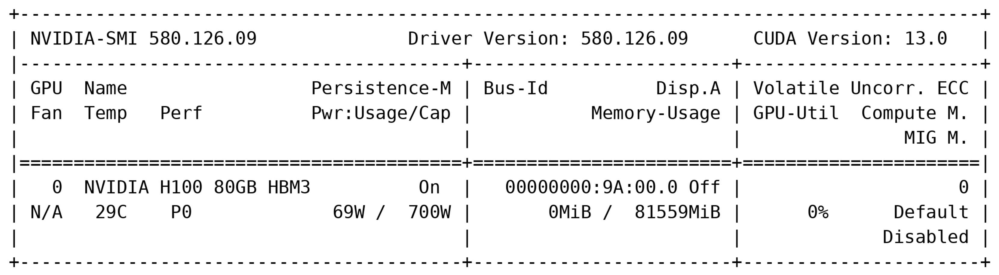

**图 1.** 通过 NVIDIA-SMI 获取的测试环境 GPU 信息。

#### 3.1.2. 软件环境

服务器运行 Ubuntu 24.04.3 LTS (Noble)，主编程语言为 Python 3.11。我们使用 Docker 29.2.1 进行容器化部署，以保证可复现性和实验间隔离。GPU 软件栈包括 NVIDIA 驱动 580.126.09 和 CUDA Toolkit 13.0。被评测的推理框架为 Ollama 0.24.0 与 vLLM 0.17.0。此外，使用 Hugging Face Transformers 4.57.6 与 huggingface_hub 0.36.2 访问模型和数据集，使用 psutil 7.2.2 与 GPUtil 1.4.0 监控系统资源。

#### 3.1.3. 测试环境准备

为保证实验客观且可重复，每次实验前都执行固定的预运行流程。首先，用专用脚本将所有 Hugging Face 模型权重和数据集预取到本地缓存，消除推理过程中的网络波动。随后由预检脚本检查 GPU 计算能力，自动为 vLLM 选择正确的量化路径：Hopper 级 GPU（计算能力 ≥ 8.9）上使用 FP8 原生精度，较旧硬件上使用 GPTQ。在本次使用的 H100 上选择了 FP8 原生路径，得到约 8-bit 权重等效的配置，与 Ollama 的 Q8_0 GGUF 格式相当，因此两个框架的量化基线是公平的。

任一时刻只有一个框架处于活跃状态。切换框架之间执行 60 秒冷却，随后可选地清除 Linux 页缓存；同一框架内切换场景之间执行 15 秒冷却。每个场景在测量前有 30 秒预热，测量后有 30–120 秒冷却。所有预热和冷却期间的测量均不计入报告结果。

每次场景前用温度检查脚本核查 GPU 温度并记录到文件。若温度超过 70 °C，则等待 60 秒后再开始测量。整个记录运行期间，各场景 GPU 温度保持在 30–32 °C 范围，确认无热节流。

我们以约每秒一次的频率，通过 psutil 与 GPUtil 采集系统资源使用情况（CPU 负载、内存占用、GPU 利用率与显存），并辅以进程级 NVIDIA-smi 监控。所有配置参数、git commit 哈希、数据集版本锁定、预检决策和工具版本均记录在结构化环境文件中，以实现完全可复现。

#### 3.1.4. 框架专属部署配置

两个框架均使用相同的 Qwen3-4B 模型权重 [29] 和相同的采样参数，以保证公平。差异仅来自内部设计选择，如批处理、KV cache 管理和 GPU 显存处理。表 1 给出了框架专属设置。

**表 1. Ollama 与 vLLM 部署的受控实验配置**

| 参数 | Ollama | vLLM |
|---|---|---|
| 框架版本 | v0.24.0 | v0.17.0 |
| 模型权重 | qwen3:4b-q8_0（GGUF） | Qwen/Qwen3-4B（HF Transformers） |
| 量化 | Q8_0（GGUF 默认） | FP8 原生（H100/Hopper） |
| 推理参数 | Temperature 0.7、Top-p 0.9、Top-k 50、Seed 0、num_ctx 4096 | Temperature 0.7、Top-p 0.9、Top-k 50、Seed 0、max_tokens 4096 |
| 批处理策略 | llama.cpp 内部队列 | Continuous batching |
| KV-Cache | FP16（llama.cpp 默认） | FP8（H100 原生） |
| GPU 显存分配 | 自动 | gpu_memory_utilization = 0.90 |
| 最大加载模型数 | 1 | 1 |
| 预热 | 30 s（不计入测量） | 30 s（不计入测量） |

对于 Ollama，我们使用 qwen3:4b-q8_0 GGUF 模型，服务端口 11436。Ollama 以默认设置运行，根据可用内存在每个模型 1–4 个并行请求间自动选择（Ollama_Num_Parallel = 4）[11]；上下文长度设为 4096 token，同一时间仅加载一个模型（Ollama_Max_Loaded_Models = 1）。KV cache 采用 FP16 精度（默认 llama.cpp 后端）[30]。

对于 vLLM，我们使用来自 Hugging Face Transformers 的 Qwen/Qwen3-4B 模型，服务端口 8002。GPU 显存利用率设为 0.90，最大并发序列数 max_num_seqs = 64，最大模型长度 4096 token。在 H100 上应用 FP8 原生量化和 FP8 KV cache。张量并行设为 1（Tensor_Parallel_Size = 1），因为所有实验均使用单卡。

两个框架通过共享参数文件保持采样参数一致：temperature 0.7、top-p 0.9、top-k 50、seed 0，无重复惩罚。必要时通过 Hugging Face tokenizer（Benchmark_Tokenizer = hf 标志）对齐 token 数。

整个流水线由单个 shell 脚本驱动，包括框架启动、健康检查、场景执行、冷却和结果聚合。每次完整运行后，脚本自动将聚合结果导出为 CSV 文件和论文级表格。

#### 3.1.5. 可复现性与实验流水线

我们在 Hugging Face Hub 上从五个公开数据集抽取确定性子样本进行评测：TriviaQA [31] 用于基线与压力场景（S1、S4），GSM8K [32] 用于数学推理，HumanEval [33] 用于代码生成，HotpotQA [34] 用于多跳问答，MT-Bench [35] 用于多轮流式对话（S3）。数据集与场景的对应关系见表 2。每个场景的样本量固定：S1、S2、S4 各 100 条，S3 为 32 段对话。子采样通过 Dataset_Seed = 0 的"打乱后选取"过程确定性完成，因此各次运行的提示词集合完全一致。

**表 2. 各场景的数据集分配及 Hub commit SHA 锁定**

| 场景 | 任务 | Hub ID | Commit SHA |
|---|---|---|---|
| S1、S4——基线/压力 | 短问答 | mandarjoshi/trivia_qa | 0f7faf33 |
| S2——推理 | 数学 | openai/gsm8k | 740312ad |
| S2——推理 | 代码生成 | openai/openai_humaneval | 7dce6050 |
| S2——推理 | 多跳问答 | hotpot_qa | 1908d6af |
| S3——流式 | 多轮对话 | HuggingFaceH4/mt_bench_prompts | e3a795c5 |

为消除推理期间的网络波动，我们在每次运行前将全部数据集分片和模型权重预取到本地缓存。每个 Hub 数据集通过环境变量锁定到特定 commit SHA，避免上游静默变更影响结果（版本锁定见表 2）。

两个框架在相同的提示词集合上先后评测，使用来自共享一致性文件（parity file）的相同采样参数（temperature 0.7、top-p 0.9、top-k 50、seed 0）。任一时刻仅有一个推理服务活跃。单个 shell 脚本驱动整条流水线：数据集预取、环境记录、框架启动、健康检查、场景执行、冷却与结果聚合。聚合指标由专门的后处理脚本导出为 CSV 和论文级表格。

所有配置参数、软件版本、数据集版本锁定、预检量化决策和 git commit 哈希均记录在各运行目录的结构化环境文件中。独立研究者可使用相同的仓库 commit 和数据集锁定复现相同的提示词集合与条件。完整的基准测试框架（包括所有脚本、Docker 配置和数据集锁定文件）已在 https://github.com/demirdagyunus/serving-compare-tests 公开（访问日期 2026-05-24）。

### 3.2. 评估指标

我们为全部四个场景定义了一组通用指标，以在不同条件下评估 Ollama 与 vLLM。所有指标均从客户端、通过共享的 HTTP 流式驱动程序采集，因此两框架间的测量一致可比。指标汇总见表 3，按基础性能、流式、token 用量、推理质量、系统资源与可扩展性分组。

**表 3. 按类别汇总的评估指标**

| 类别 | 指标 | 单位 | 适用场景 |
|---|---|---|---|
| 核心性能 | 端到端延迟（avg、P95、P99） | ms | 全部场景 |
| 核心性能 | TTFT | ms | 全部场景 |
| 核心性能 | 吞吐量 | req/s 或 task/s | 全部场景 |
| 核心性能 | token 生成速率 | tok/s | 全部场景 |
| 核心性能 | 错误率 | % | 全部场景 |
| 任务质量 | 推理准确率（数学、代码、问答） | 0–1（启发式） | S2 |
| 流式 | 对话完成率 | % | S3 |
| 流式 | 每请求带宽 | KB | S3 |
| 资源 | CPU/内存/GPU 利用率 | %/MB | 全部场景 |
| 可扩展性 | 断点、恢复时间 | 并发用户数/秒 | S4 |
| 可扩展性 | 内存增长速率 | MB/小时 | S4 |

核心性能指标刻画系统的基本行为，包括端到端延迟、吞吐量、TTFT、token 生成速率和错误率。端到端延迟指从发出 HTTP 请求到收到完整响应的墙钟时间，包含客户端开销、网络往返时间、服务端排队、prefill 与 decode。我们没有对这些部分分别插桩，因此所有延迟均为客户端观测的端到端值。TTFT 是流式模式下从请求到收到第一个非空 token 的时间，四个场景均有报告。延迟与 TTFT 仅由成功请求计算：失败或超时请求不计入均值与分位数，但计入错误率。

推理与任务特定指标在场景 2 中报告，包括数学推理、代码生成和多跳问答的启发式准确率。这些分数使用轻量代理方法，不涉及人工标注或 LLM-as-judge 评估，因此只能视为负载下输出质量的近似指标。

流式与会话指标在场景 3 中报告，包括 TTFT、每秒 token 数、对话完成率和每请求带宽。连贯性与上下文保持分数采用启发式方法，应视为近似指标而非精确的质量测量。

系统资源指标测量推理期间的硬件占用，包括 CPU 负载、内存占用、GPU 利用率和 GPU 显存，以约每秒一次的频率通过 psutil 与 GPUtil 采集，并辅以进程级 NVIDIA-smi 监控。

可扩展性与压力指标在场景 4 中报告，包括断点、恢复行为、渐增与尖峰负载下的吞吐下降，以及耐久测试期间的长期内存增长。测量工具未导出服务端内部队列深度或缓存命中率，因此不予报告。过载下的延迟反映排队延迟与推理时间的叠加（客户端视角）。所有时间以秒记录，除非另有说明，表格与图中转换为毫秒。

表 4 给出了性能指标的定义与公式。时间以秒记录，除非另有说明，在表格和图中转换为毫秒。延迟与 TTFT 仅从成功请求计算：失败请求不计入平均值，但计入错误率。

**表 4. 所有实验场景使用的指标公式与定义**

| 指标 | 描述 | 公式 |
|---|---|---|
| 响应延迟 | 从发起请求到收到最后一个 token 的端到端墙钟时长 | Latency_i = t_i(last_token) − t_i(request) |
| 平均延迟 | 所有成功请求的平均延迟 | Latency_avg = (1/N) Σ Latency_i |
| 分位数延迟 | 一定百分比请求完成时低于该值的延迟 | Latency_pX = Percentile_X({Latency_1,…,Latency_N})，X ∈ {50, 75, 90, 95, 99, 99.9} |
| 吞吐量 | 单位时间内的成功请求数或生成 token 数（N 为请求数，T 为总测试时长） | Throughput_req = SuccessfulRequests / T；Throughput_tokens = TotalTokens / T |
| 错误率 | 失败请求占总请求的比例 | ErrorRate = FailedRequests / TotalRequests × 100% |
| 首 token 时间（TTFT） | 从发起请求到收到首个非空 token 的时间；包含网络开销，代表客户端观测的响应性 | TTFT_i = t_i(first_token) − t_i(request) |
| 资源利用率 | 推理期间的 CPU、GPU 与内存占用；通过 psutil 和 GPUtil 以约 1 s 间隔测量，GPU 指标辅以 NVIDIA-smi 进程监控 | — |
| 性能退化 | 指标相对基线并发级别的百分比变化 | 基于延迟：升高表示退化；基于吞吐：降低表示退化 |

**指标定义与测量方法**

为保持指标清晰一致，我们从统一的客户端视角定义所有指标。请求生命周期如图 2 所示。

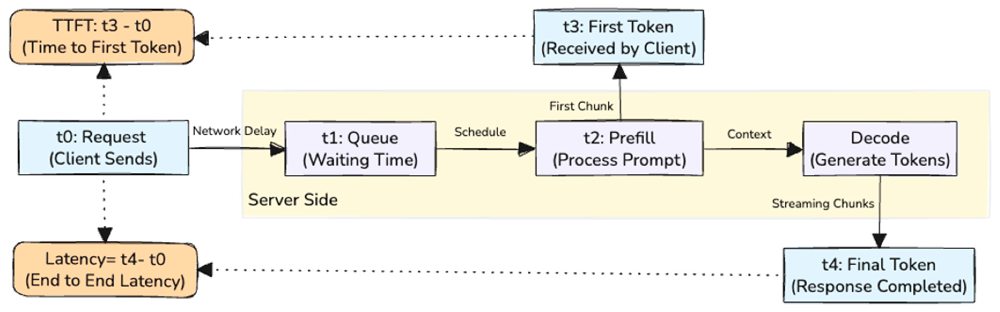

**图 2.** 用于指标定义的概念化请求时间线。

在该时间线中，t0 是客户端发出流式 HTTP 请求的时刻，t3 是收到第一个非空 token 的时刻，t4 是完整流式响应结束的时刻。中间阶段（网络传输、服务端排队和推理即 prefill 与 decode）仅作概念展示；测量工具未对其分别插桩。因此，所有报告的延迟和 TTFT 均为包含上述全部部分的客户端观测端到端值。

端到端延迟记为 t4 − t0：从请求到最后一个 token 的墙钟时间。场景 1 中报告为"延迟"，场景 2、3、4 中报告为"完成时间"，两者指同一客户端观测值。

TTFT 记为 t3 − t0：从请求到第一个非空 token 的时间。四个场景均使用流式，因此全部报告 TTFT。TTFT 包含网络开销、服务端调度延迟和 prefill，反映的是客户端感知的响应性，而非孤立的模型推理时间。

所有请求均通过 HTTP 流式发送。计时起点 t0 在客户端驱动发出流式请求之前记录。延迟与 TTFT 的平均值仅由成功请求计算；失败与超时请求计入错误率，但不计入延迟、TTFT 与 token 速率。

吞吐量为成功请求数除以总测试时长，应与错误率一起解读。token 生成速率为补全 token 数除以每请求的端到端时间。

质量类指标（场景 2 的推理质量，场景 3、4 的响应连贯性、响应质量与上下文保持）采用轻量启发式评分，不使用人工标注或 LLM-as-judge 评估，应视为负载下输出质量的近似代理指标，而非经过验证的质量测量。

测量工具未分别对服务端排队等待时间与纯推理时间插桩，因此我们对观测延迟在排队与推理之间的划分不作声明。所有报告值均为客户端观测的综合测量。

### 3.3. 统计分析

每个场景在每个并发级别作为单次连续运行执行，并在整个测试时长内聚合每请求统计。除平均值外，我们还报告分位数分布（P50、P75、P90、P95、P99）、最小/最大值，以及便于阅读的变异性图。

我们使用基于分位数的统计分析延迟和 TTFT，因为并发负载下的推理延迟不服从高斯分布。这遵循大规模服务系统尾延迟分析的通行做法 [36]。我们也视情况使用误差线和范围图展示请求级波动。

失败与超时请求不计入延迟和 TTFT 的均值，但计入错误率。由于测量工具未分别对服务端排队时间和推理时间插桩，所有报告的延迟均为客户端观测的端到端综合值（定义见"指标定义与测量方法"）。

若干分布严重偏斜且在过载下不稳定（尤其是高并发下的 Ollama），因此我们的分析以描述性统计为主，而非基于正式的参数显著性检验。

### 3.4. 测试场景

为研究 Ollama 与 vLLM 在不同条件下的行为，我们设计了四个场景，分别关注部署的不同侧面：基线性能、复杂推理、流式质量与压力韧性。所有场景使用相同的 HTTP 流式客户端路径、相同的采样参数和单张 GPU；两框架之间的唯一差异即推理后端本身。

#### 3.4.1. 场景 1：基线性能（简单问答）

测量两框架在 TriviaQA 数据集 [31] 短事实问答任务上的基础性能，关注不同并发级别下的延迟、吞吐与错误率。

- 模型：Qwen3-4B
- 并发：10、50、100 请求
- 时长：每级 180 s
- 预热：30 s（不计入测量）
- 指标：端到端延迟（avg、P95、P99）、TTFT、吞吐（req/s）、token 生成速率、错误率与系统资源占用

#### 3.4.2. 场景 2：复杂推理

评估三类多步推理任务：数学解题 [37]（GSM8K）、代码生成 [38]（HumanEval）和多跳问答 [39]（HotpotQA），关注中等并发下的任务完成时间、启发式推理准确率与资源占用。

- 模型：Qwen3-4B
- 并发：20、50、100 任务
- 时长：每级 180 s
- 预热：30 s；冷却：60 s
- 指标：端到端完成时间、TTFT、启发式准确率（数学、代码、问答）、token 生成速率、错误率与内存占用

#### 3.4.3. 场景 3：流式与会话

研究流式响应能力与会话质量。使用 MT-Bench [35] 提示词集的多轮对话，评估两框架实时交付 token 以及跨轮保持上下文的能力。

- 模型：Qwen3-4B
- 并发：50–150 段对话
- 时长：每级 900 s
- 预热：30 s；冷却：60 s
- 指标：TTFT、每秒 token 数、对话完成率、启发式连贯性与响应质量分数、上下文保持与每请求带宽

#### 3.4.4. 场景 4：压力与可扩展性

探明断点、可扩展性极限与长期稳定性。分三步：渐增加压测试（ramp）、尖峰测试（spike）与长时间耐久阶段（endurance），在持续升高的负载下施压直至性能下降或失败。实验使用 TriviaQA 数据集。

- 模型：Qwen3-4B
- 并发：10–500（渐增）；耐久阶段固定负载
- 时长：每级 ramp 300 s；耐久 3600 s
- 预热：30 s；冷却：120 s
- 指标：断点（并发用户数）、恢复时间、吞吐下降、内存增长速率（MB/小时）与错误率

每个场景以 30 秒预热开始（不计入结果）。场景 1、2 每级运行 180 s，场景 3 每级运行 900 s 以捕捉持续负载下的会话行为，场景 4 每级 ramp 300 s 后接 3600 s 耐久阶段。场景 1、2、3、4 之后的冷却分别为 30、60、60、120 s。

## 4. 实验结果

我们进行了四组实验，展示 Ollama 与 vLLM 在并发增加时的行为。本节报告 3.4 节所述四个场景的结果，目标是在表 5 所列的并发级别下，从基线性能到复杂推理、流式与压力测试全面比较两框架。

**表 5. 场景汇总**

| 场景 | 目标 | 数据集 | 并发 | 关键指标 |
|---|---|---|---|---|
| 1. 基线性能 | 评估简单问答任务下的延迟、吞吐与错误率 | TriviaQA | 10、50、100 | 延迟（avg、P95、P99）、TTFT、吞吐、错误率、资源占用 |
| 2. 复杂推理 | 评估多步任务中的推理准确率与资源利用 | GSM8K、HumanEval、HotpotQA | 20、50、100 | 完成时间、TTFT、准确率（数学、代码、问答）、内存占用 |
| 3. 流式与会话 | 测量流式响应能力与对话质量 | MT-Bench | 50、150 | TTFT、token/s、连贯性、对话完成率、带宽 |
| 4. 压力与可扩展性 | 探明断点、恢复行为与长期稳定性 | TriviaQA | 10–500（渐增）、耐久 | 断点、恢复时间、内存增长、吞吐退化 |

每个场景同时报告性能指标（延迟、吞吐、错误率、TTFT、准确率）与系统级测量（CPU、GPU、内存占用），并给出均值、标准差和分位数（P95、P99）等统计摘要以展示波动。每个场景在每个并发级别作为单次连续运行执行，并在整个测试时长内聚合每请求统计。我们用折线图和柱状图展示趋势，用表格展示详细数值，从而在细粒度和高层次上同时比较两框架。

### 4.1. 场景 1：基线性能（简单问答）

第一组实验在 TriviaQA 简单问答任务上评测 Ollama 与 vLLM 的基线性能（Qwen3-4B）。每个并发级别（10、50、100 请求）运行 180 s，含 30 s 预热（不计入结果）。最大输出长度设为 256 token。指标为端到端延迟、吞吐、TTFT、token 生成速率、错误率与系统资源占用。

表 6 汇总了三个并发级别的基线结果，包括均值与分位数延迟、吞吐、token 生成速率、TTFT、错误率与资源占用，所有值聚合自 180 s 运行。如表 6 所示，vLLM 在延迟、吞吐和 token 生成上大幅领先，而 Ollama 退化迅速，在中等并发之后开始失败。

**表 6. Ollama 与 vLLM 在各并发级别下的基线性能汇总**

| 并发 | 平台 | 平均延迟 (s) | P95 延迟 (s) | P99 延迟 (s) | 吞吐 (req/s) | Token/s | TTFT 均值 (s) | 错误率 | CPU (%) | 内存 (%) |
|---|---|---|---|---|---|---|---|---|---|---|
| 10 | Ollama | 20.92 | 26.65 | 26.89 | 0.45 | 1.53 | 20.75 | 0.0 | 9.3 | 17.0 |
| 10 | vLLM | 3.71 | 3.74 | 4.11 | 2.61 | 499.33 | 0.07 | 0.0 | 3.9 | 35.5 |
| 50 | Ollama | 89.72 | 114.03 | 114.58 | 0.46 | 0.16 | 89.70 | 0.0 | 10.1 | 17.2 |
| 50 | vLLM | 4.02 | 4.15 | 4.26 | 11.93 | 2266.30 | 0.11 | 0.0 | 4.7 | 40.0 |
| 100 | Ollama | 100.48 | 126.09 | 128.81 | 0.45 | 0.65 | 100.40 | 39.29 | 10.3 | 17.1 |
| 100 | vLLM | 6.37 | 7.94 | 8.50 | 15.20 | 2891.13 | 2.25 | 0.0 | 6.0 | 40.5 |

图 3a 以对数刻度展示两框架的端到端延迟，数量级差距一目了然。vLLM 即使在 100 并发下仍将延迟保持在 10 s 以下；Ollama 则急剧退化：平均延迟从 10 用户时的约 21 s 升至 100 用户时的 100 s 以上，P99 超过 128 s。在每个并发级别，vLLM 的平均延迟约为 Ollama 的 1/5–1/25，且差距随并发增大。对数刻度还显示 vLLM 的延迟增长缓慢，而 Ollama 在 10–50 用户之间陡升。图 3b 显示 vLLM 在所有级别下的吞吐都远高于 Ollama：从 10 用户时的 2.61 req/s 扩展到 100 用户时的 15.20 req/s，而 Ollama 停滞在约 0.45 req/s。这表明 Ollama 的内部队列在其设定上限之外无法并行处理更多请求，而 vLLM 的 continuous batching 使吞吐随并发扩展。

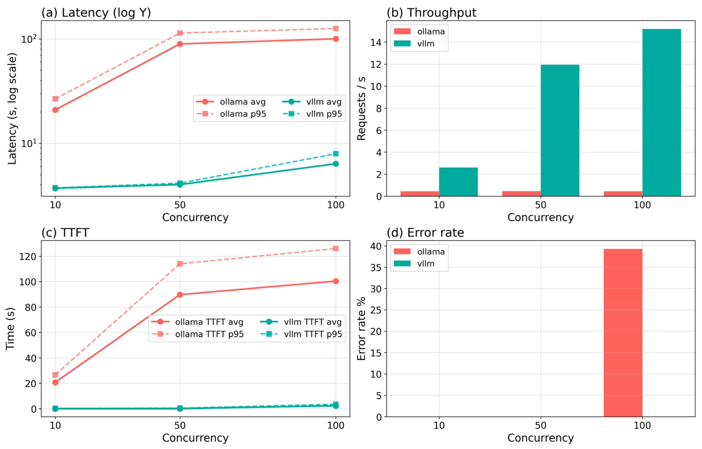

**图 3.** Ollama 与 vLLM 在各并发级别下的 (a) 端到端延迟（对数刻度）、(b) 吞吐量、(c) TTFT 与 (d) 错误率。

从报告 token 生成速率的表 6 可见，vLLM 达到 499–2891 token/s 并随并发扩展，而 Ollama 在所有级别均低于 2 token/s，峰值并发下相差约三个数量级。我们观察到，vLLM 的 PagedAttention 与 continuous batching 能把并发需求转化为实际生成吞吐，远胜 Ollama 的 llama.cpp 后端。

图 3c 展示了 TTFT 差异。vLLM 即使在 100 用户下 TTFT 仍低于 3 s，而 Ollama 的 TTFT 随并发增长，在最高级别超过 100 s。这对交互式使用至关重要——TTFT 决定系统体感速度。结果表明 Ollama 在负载下无法快速开始生成 token，因为请求在 prefill 开始前就在其内部队列中堆积。

图 3d 报告各级别的错误率。vLLM 所有级别错误率为 0%，5498 个请求全部完成。Ollama 在 10 和 50 用户时无错误，但 100 用户时基于超时的失败率达 39.29%（224 个请求中 88 个未在超时前完成）。如图 3d 所示，Ollama 在该硬件上进行基线问答的有效并发上限介于 50–100 用户之间。

图 4 汇总了资源占用。Ollama 的 CPU 略高（约 9–10% 对 vLLM 的 4–6%），但产出少得多。GPU 占用上 vLLM（35–41%）远高于 Ollama（17%），说明 vLLM 通过 continuous batching 与 H100 上的 FP8 原生执行更充分地利用了 GPU。内存占用两者相近（约 6%）。因此主要差异在于计算效率而非内存。综上，vLLM 的高吞吐低延迟并非靠占用更多 CPU，而是靠更充分地利用 GPU。

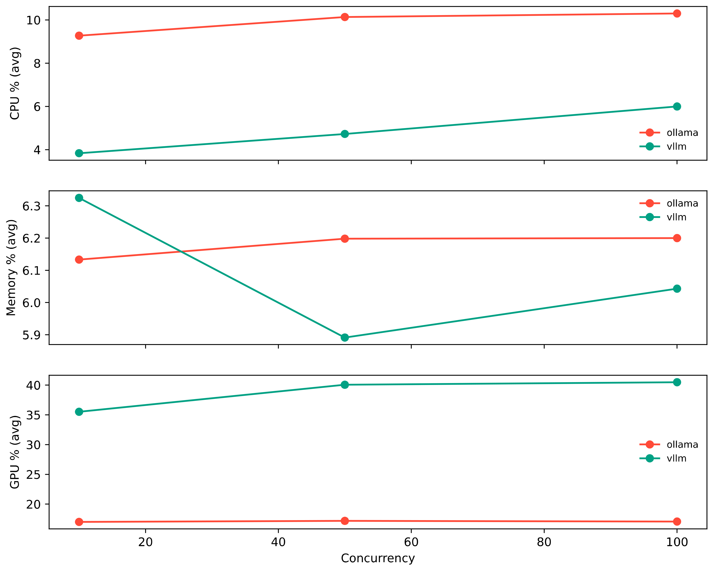

**图 4.** Ollama 与 vLLM 在各并发级别下的系统级资源利用率。

基线实验证实 vLLM 提供了高得多的吞吐（100 用户时 15.20 对 0.45 req/s）、更低的延迟（10 s 以下对 100 s 以上）和 0% 错误率，而 Ollama 失败 39.29% 的请求。因此在测试条件下，vLLM 是并发问答更高效的框架。

我们还考察了变异性以更好地刻画各级别行为。分位数统计（P50–P99）与最小–最大范围显示，vLLM 随并发上升保持高度稳定，各级别标准差低于 1 s；而 Ollama 的方差和范围大得多，100 用户时标准差接近 16 s。失败请求不计入延迟值，但计入错误率。总体上，vLLM 提供更可预测、更可扩展的性能，而 Ollama 在中等并发之后变得不稳定。表 7 汇总了场景 1 的延迟变异性。汇总表中的标准差（SD）是由 P95 延迟估计的近似值，仅反映大致波动；分位数（P50–P99）是更可靠的变异性度量。

**表 7. 场景 1 补充统计汇总**

| 并发 | 平台 | 平均延迟 (s) | SD (s) |
|---|---|---|---|
| 10 | Ollama | 20.92 | 3.48 |
| 10 | vLLM | 3.71 | 0.02 |
| 50 | Ollama | 89.72 | 14.78 |
| 50 | vLLM | 4.02 | 0.08 |
| 100 | Ollama | 100.48 | 15.57 |
| 100 | vLLM | 6.37 | 0.96 |

### 4.2. 场景 2：复杂推理

第二组实验在三个 Hugging Face 数据集的多步推理任务上评测两框架：GSM8K（数学解题）、HumanEval（代码生成）和 HotpotQA（多跳问答）。每个并发级别（20、50、100 任务）运行 180 s，含 30 s 预热。指标为端到端完成时间、TTFT、按任务类型的启发式准确率、吞吐、token 生成速率、错误率与资源占用。

表 8 汇总了三个并发级别的推理结果，包括均值与分位数完成时间、吞吐、token 生成速率、总体准确率、平均推理步数、错误率与 GPU 占用，均聚合自 180 s 运行。如表 8 所示，vLLM 在所有指标上均优于 Ollama，且差距随并发增大。

**表 8. Ollama 与 vLLM 在各并发级别下的复杂推理性能汇总**

| 并发 | 平台 | 平均完成 (s) | P95 (s) | P99 (s) | 吞吐 (task/s) | Token/s | 总体准确率 | 推理步数 | 错误率 (%) | GPU (%) |
|---|---|---|---|---|---|---|---|---|---|---|
| 20 | Ollama | 41.87 | 46.60 | 46.83 | 0.44 | 32.29 | 0.00 | 0.00 | 0.00 | 16.6 |
| 20 | vLLM | 3.81 | 3.86 | 3.93 | 5.02 | 1535.80 | 0.46 | 15.11 | 0.0 | 39.1 |
| 50 | Ollama | 93.75 | 119.03 | 120.17 | 0.43 | 27.62 | 0.00 | 0.00 | 0.0 | 16.8 |
| 50 | vLLM | 4.02 | 4.13 | 4.56 | 12.03 | 3648.36 | 0.44 | 15.07 | 0.0 | 42.2 |
| 100 | Ollama | 101.75 | 126.30 | 128.38 | 0.44 | 29.61 | 0.00 | 0.00 | 40.0 | 16.8 |
| 100 | vLLM | 6.19 | 7.57 | 7.92 | 15.55 | 4692.32 | 0.45 | 15.09 | 0.0 | 43.7 |

图 5a 展示完成时间差异：vLLM 即使在 100 任务下完成时间仍低于 7 s，而 Ollama 从 20 任务时的约 42 s 升至 100 任务时的 101 s 以上。值得注意的是，vLLM 通过 continuous batching 并行化推理工作，而 Ollama 在其设定上限之外只能串行执行任务。图 5b 同时呈现吞吐与 token 速率：vLLM 从 20 任务时的 5.02 task/s、1536 tok/s 扩展到 100 任务时的 15.55 task/s、4692 tok/s，接近线性扩展；Ollama 停滞在约 0.44 task/s 和 27–32 tok/s，表明其调度无法把额外需求转化为推理吞吐。

（原文图 5 为多面板图，PDF 位图未提取到；请查阅原文。）

**图 5.** Ollama 与 vLLM 在各并发级别下的 (a) 平均任务完成时间、(b) 吞吐与 token 生成速率（双轴）、(c) 按任务类型的准确率分解（总体、数学、代码、多跳问答）与 (d) 每任务平均推理步数。

图 5c 按任务类型分解启发式准确率。vLLM 在所有级别保持一致：总体准确率 0.44–0.46，其中多跳问答最强（0.57–0.61），代码居中（0.43–0.45），数学最弱（0.32）。Ollama 在所有任务类型和级别均报告 0.00 准确率——这很可能来自负载下的严重截断和超时导致的不完整输出，而非纯粹的错误答案。该结果应与高完成时间和 100 任务时 40% 的错误率一起解读。

图 5d 报告每任务平均推理步数。vLLM 在所有级别每任务约 15 步，反映稳定的思维链行为；Ollama 为 0 步，与准确率结果一致：高延迟与超时压力下，其输出要么不完整，要么不含可检测的推理。

图 6 报告各框架按任务类型处理的总任务数。vLLM 处理 6044 个任务而 Ollama 仅 442 个的巨大差距来自吞吐差距而非采样差异——两框架从相同的提示词池、按相同的任务类型配比抽样。100 任务时，Ollama 因超时仅完成 220 个尝试任务中的 132 个，而 vLLM 完成了全部 2916 个尝试任务。

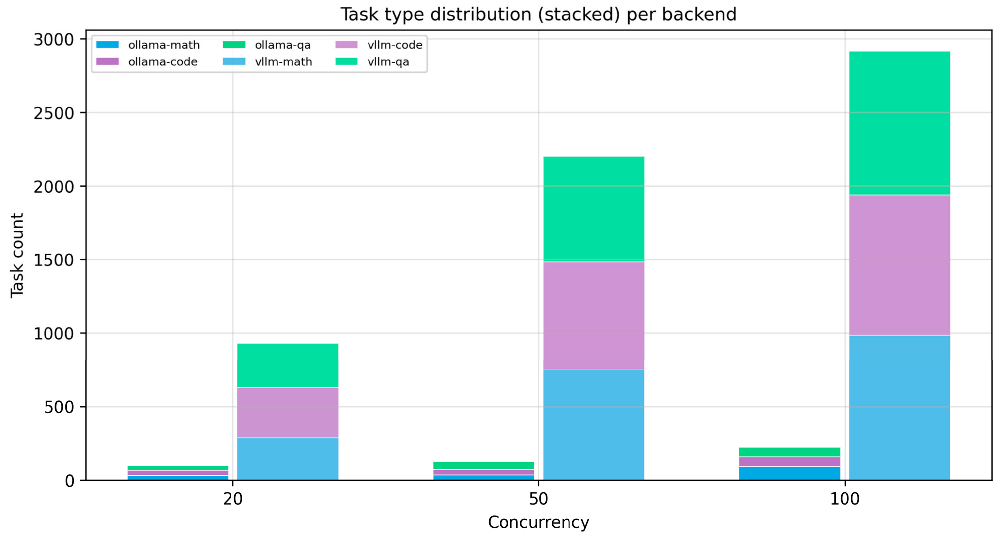

**图 6.** 各框架在各并发级别下处理的任务类型分布（数学、代码、问答）。

推理实验证实 vLLM 提供高一个数量级的吞吐（100 任务时 15.55 对 0.44 task/s）、快 16 倍的完成时间（6.19 s 对 101.75 s）和 0% 错误率，而 Ollama 因超时失败 40% 的任务。我们还发现 vLLM 在所有任务类型上保持了可测的准确率，而 Ollama 的输出在测试条件下未达到启发式正确性标准。

表 9 汇总了场景 2 的延迟变异性。推理工作负载产生了非常偏斜的完成时间分布（尤其过载下的 Ollama），因此我们除平均值外还考察了分位数与变异性。Ollama 在 100 任务时因超时和调度不稳定表现出很大的完成时间方差，而 vLLM 在所有级别保持稳定，标准差低于 1 s。失败与超时请求不计入完成时间值，但计入错误率。总体上，vLLM 在持续负载下提供更一致的推理性能。

**表 9. 场景 2 补充统计汇总**

| 并发 | 平台 | 平均完成 (s) | SD (s) |
|---|---|---|---|
| 20 | Ollama | 41.87 | 2.87 |
| 20 | vLLM | 3.81 | 0.03 |
| 50 | Ollama | 93.75 | 15.37 |
| 50 | vLLM | 4.02 | 0.07 |
| 100 | Ollama | 101.75 | 14.93 |
| 100 | vLLM | 6.19 | 0.84 |

### 4.3. 场景 3：流式与会话

第三组实验使用 MT-Bench 提示词集的多轮对话评测两框架的实时流式能力。每个并发级别（50、150 段对话）运行 900 s，含 30 s 预热。会话长度设为 5 轮，每轮最大输出 256 token。指标为 TTFT、端到端完成时间、token 生成速率、请求与会话吞吐、带宽占用、流式分块数、响应连贯性与上下文保持。流式在聊天机器人、语音助手和客服等生产系统中至关重要——延迟直接影响用户体验。多轮对话本身也是活跃的研究方向，近期综述综述了基于 LLM 的对话系统的进展，以及跨轮保持响应性与上下文的挑战 [40]。

表 10 汇总流式结果，包括均值与分位数完成时间、TTFT、吞吐、token 速率、对话完成率、错误率与启发式质量分数。如表 10 所示，vLLM 几乎在所有指标上大幅领先，尤其是 TTFT、token 速率与可靠性。

**表 10. Ollama 与 vLLM 在各并发级别下的流式与会话测试汇总**

| 平台 | 平均完成 (s) | TTFT 均值 (s) | TTFT P95 (s) | 吞吐 (req/s) | 会话吞吐 (conv/s) | 平均 token/s | 每请求带宽 (KB) | 连贯性 | 上下文保持 | 错误率 (%) |
|---|---|---|---|---|---|---|---|---|---|---|
| Ollama @50 | 101.92 | 101.31 | 116.86 | 0.47 | 0.06 | 0.58 | 0.26 | 0.74 | 0.07 | 0.00 |
| vLLM @50 | 4.29 | 0.13 | 0.22 | 11.36 | 0.55 | 57.56 | 1.37 | 0.78 | 1.00 | 0.0 |
| Ollama @150 | 118.17 | 117.54 | 128.27 | 0.46 | 0.14 | 0.47 | 0.30 | 0.76 | 0.07 | 61.29 |
| vLLM @150 | 9.64 | 5.51 | 6.77 | 15.29 | 1.57 | 26.56 | 1.35 | 0.81 | 1.00 | 0.0 |

图 7a 呈现完成时间与 TTFT。150 段对话时 vLLM 完成时间低于 10 s、TTFT 低于 6 s；Ollama 完成时间超过 100 s，且 TTFT 与完成时间几乎相同。值得注意的是，Ollama 的输出是整块给出而非流式。这与 Ollama 在 token 流开始前队列即被填满的情况相符——大部分墙钟时间耗在队列等待而非交付 token。

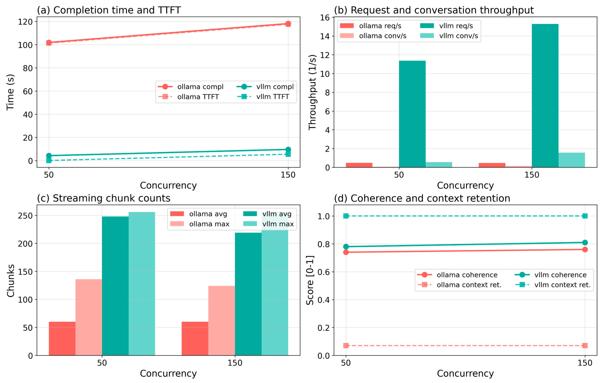

**图 7.** Ollama 与 vLLM 在各流式并发级别下的 (a) 完成时间与 TTFT、(b) 请求与会话吞吐、(c) 流式分块数（平均与最大）以及 (d) 启发式响应连贯性与上下文保持分数。

token 速率分布呈现类似的悬殊：vLLM 在 50 段对话时达 57.56 token/s、150 段时 26.56 token/s（P99 为 33.49–69.82 tok/s）；Ollama 两级均低于 1 token/s（P99 为 0.91–1.02 tok/s）。50–60 倍的差距凸显了两者实时生成能力的鸿沟。

图 7b 呈现请求与会话吞吐。vLLM 从 50 段时的 11.36 req/s、0.55 conv/s 扩展到 150 段时的 15.29 req/s、1.57 conv/s；Ollama 停滞在约 0.46 req/s、0.06–0.14 conv/s。巨大差距证实 Ollama 无法把并发需求转化为流式吞吐。每请求带宽也不同：vLLM 每请求约 1.35–1.37 KB，Ollama 仅 0.26–0.30 KB。这源于 vLLM 更长更完整的响应：vLLM 在测试窗口内产生 1630–1810 万 token，而 Ollama 仅 3 万–3.4 万。因此 Ollama 较低的带宽并非优势，而是每请求产出少得多的结果。

图 7c 报告每请求流式分块数。vLLM 平均每请求 219–248 个分块（最大 256），与 streaming_chunk_size = 1 的设置一致，体现细粒度流式；Ollama 平均约 60 个分块（最大 124–136），反映更短的响应和更粗的流式粒度。这与 TTFT 结果一致：Ollama 负载下的流式被上游队列延迟拖累。

图 7d 呈现启发式连贯性与上下文保持分数。连贯性两框架相近（Ollama 0.74–0.76，vLLM 0.78–0.81），说明 Ollama 已完成的请求文本质量尚可。但上下文保持差距巨大：vLLM 两级均为 1.00，而 Ollama 仅 0.07——因为 Ollama 只完成了很小比例的多轮对话（50 并发时 239 段中完成 57 段，150 并发时 673 段中完成 141 段），无法跨轮积累上下文。

流式实验显示出可靠性与响应性的明显差距。150 段对话时 Ollama 基于超时的错误率达 61.29%（1209 个请求中 741 个失败），而 vLLM 在全部 24,187 个流式请求中错误率为 0%。TTFT 差距巨大：vLLM 在 0.13–5.51 s 内交付首个 token，Ollama 需要 101–118 s，视并发而定相差 20–800 倍。因此，在测试级别下 Ollama 不适合实时流式，而 vLLM 始终保持生产级流式。

流式负载在并发上升时产生不均匀的延迟分布，因此我们对 TTFT 与流式延迟除平均值外还使用分位数统计（P50–P99）。vLLM 的 TTFT 方差低得多、流式更稳定，尤其在高并发下。150 段对话时，尽管 Ollama 的 TTFT 均值被压在 120 s 超时附近，其标准差仍超过 6 s，而 vLLM 保持亚秒级 TTFT 方差。最小–最大范围还显示 Ollama 在流式期间的响应时间极不稳定，损害用户体验。表 11 汇总流式场景的 TTFT 统计，报告两框架在两个并发级别的平均 TTFT 与标准差，反映流式期间 TTFT 的稳定性。

**表 11. 场景 3 补充统计汇总**

| 平台 | 平均 TTFT (s) | SD (s) |
|---|---|---|
| Ollama @50 | 101.31 | 9.46 |
| Ollama @150 | 117.54 | 6.53 |
| vLLM @50 | 0.13 | 0.06 |
| vLLM @150 | 5.51 | 0.77 |

### 4.4. 场景 4：压力测试与可扩展性

第四组实验评估两框架在高并发负载下的韧性与可扩展性。分三步：从 10 逐步升到 500 用户的渐增加压测试、模拟突发负载激增的尖峰测试，以及在稳定中等负载下 3600 s 的耐久阶段。三者共同展示了短期断点与长期稳定性。与本研究的早期版本不同，Ollama 与 vLLM 本次均完成了全部压力阶段，因此可在整条流水线上直接比较。

表 12 汇总渐增加压结果，包括总请求数、成功请求数、吞吐、平均与 P95 延迟、错误率，以及每级是否触发断点判据。Ollama 在第一级（10 用户）即达断点，而 vLLM 稳定到 200 用户后才出现性能下降。

**表 12. Ollama 与 vLLM 在各并发级别下的渐增加压测试结果**

| 平台 | 负载 | 请求数 | 成功数 | 吞吐 (req/s) | 平均延迟 (s) | P95 延迟 (s) | 错误率 | 断点 |
|---|---|---|---|---|---|---|---|---|
| Ollama | 10 | 146 | 146 | 0.46 | 21.13 | 26.21 | 0.0 | 是 |
| vLLM | 10 | 780 | 780 | 2.57 | 3.74 | 3.80 | 0.0 | 否 |
| vLLM | 25 | 1882 | 1882 | 6.18 | 3.86 | 3.94 | 0.0 | 否 |
| vLLM | 50 | 3561 | 3561 | 11.70 | 4.06 | 4.17 | 0.0 | 否 |
| vLLM | 100 | 4819 | 4819 | 15.67 | 5.97 | 7.24 | 0.0 | 否 |
| vLLM | 200 | 4872 | 4872 | 15.46 | 12.23 | 14.34 | 0.0 | 是 |

如图 8 所示，vLLM 扩展良好：吞吐从 10 用户时的 2.57 req/s 升至 100 用户时的峰值 15.67 req/s，随后在 200 用户时趋平于约 15.46 req/s，同时延迟从约 6 s 升至 12 s 以上。这说明 vLLM 的 continuous batching 在约 100 用户以内高效利用 GPU，此后额外负载在队列中积压而非转化为吞吐。相比之下，Ollama 在 10 用户即达断点，平均延迟超过 21 s、吞吐仅 0.46 req/s，证实其在该硬件上连中等的并发服务都无法承载。

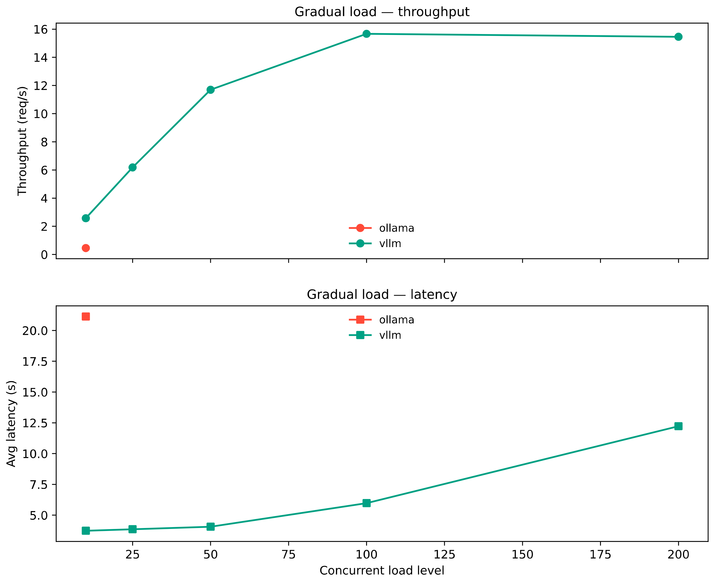

**图 8.** 渐增加压测试结果：Ollama 与 vLLM 的吞吐（上）与平均延迟（下）随并发负载水平的变化。虚线竖线表示各框架的断点负载。

图 9 呈现尖峰测试结果。vLLM 在所有测试峰值负载（10–200 用户）下每次尖峰后约 63–64 s 恢复，恢复行为可预测。Ollama 在 10 用户尖峰后需约 164 s 恢复（比 vLLM 长 2.5 倍以上），且因无法维持基线并发而无法在更高的尖峰负载下测试。在已完成的尖峰阶段，两框架的峰值错误率均为 0%。

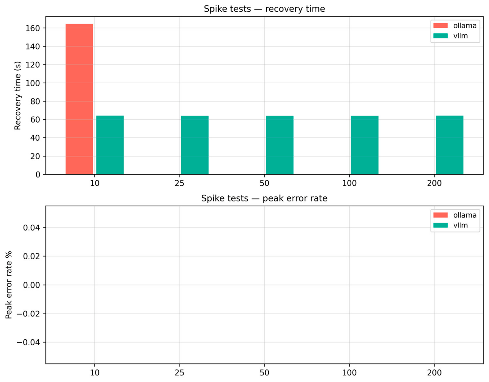

**图 9.** 尖峰测试结果：突发负载激增后的恢复时间（上）与尖峰期间峰值错误率（下）。

如图 10 所示，耐久测试揭示了 60 分钟窗口内不同的资源模式。Ollama 的 CPU 占用约 10–12%、频繁冲高到 25% 以上，vLLM 稳定在 4–6%、偶有峰值。GPU 占用相反：vLLM 全程保持约 35–45%（体现良好的 continuous batching），Ollama 停留在 15–20% 左右（GPU 利用不足）。两框架内存均呈渐进而非稳定增长：vLLM 在约 5–7% 之间呈阶梯式变化，Ollama 停留在 6.5–6.8% 附近并小幅漂移。

（原文图 10 为 60 分钟耐久阶段的资源时间线，PDF 位图未提取到；请查阅原文。）

**图 10.** Ollama 与 vLLM 在 60 分钟持续负载下的耐久阶段资源时间线（CPU、内存、GPU 利用率）。

耐久阶段的总内存增长幅度不同（见图 10）：3600 s 窗口内 vLLM 增长约 14,219 MB，Ollama 增长约 5602 MB。总体上，两框架在持续使用中都表现出显著的内存增长，生产环境应加以监控。需要说明的是，这是资源监控器观测到的累计增量，而非稳态泄漏速率。vLLM 的较高增长部分可以解释为：其 KV cache 与批处理缓冲区在远高于 Ollama 的吞吐下扩张。

渐增加压阶段，vLLM 在所有负载下的一致性分数保持在 0.81–0.98，最低值（0.81）出现在 100 用户（即吞吐峰值点）；其质量分数保持在 0.64–0.68。Ollama 仅在 10 用户下测试，质量与一致性分数分别为 0.75 和 0.82。因此，压力下的性能退化主要影响吞吐与延迟，而非已完成请求的质量。

耐久阶段，vLLM 保持约 15.7 req/s、窗口内平均完成时间 6 s，完成 56,345 个请求；Ollama 约 0.5 req/s、平均完成时间 20.7 s，完成 1722 个请求。持续使用下 30 倍的吞吐差距证实了 vLLM 在长时间工作负载上的优势。

压力结果显示两框架在并发上升时的退化方式截然不同。vLLM 扩展到 200 用户才出现性能下降，主要退化是延迟上升和队列积压，而非失败；Ollama 在该硬件上的有效上限是 10 用户或更低，并发负载下吞吐立即停滞。

如表 13 所示，两框架在稳定运行并发上相差约一个数量级。vLLM 在全部 95,108 个跟踪请求上以 0% 错误率完成所有渐增、尖峰与耐久测试；Ollama 在相同条件下仅完成 2162 个跟踪请求。vLLM 长期使用的主要关注点是观测到的内存增长与超过 100 用户后的延迟上升，两者在生产中都应监控。

**表 13. 压力测试中观测到的失败阈值与断点**

| 服务 | 稳定并发范围 | 退化区间 | 断点 | 主导失败行为 |
|---|---|---|---|---|
| Ollama | ≤10 用户 | 10–25 用户 | ≥10 用户 | 吞吐停滞、队列饱和、尖峰后恢复缓慢 |
| vLLM | ≤100 用户 | 100–200 用户 | ≥200 用户 | 延迟渐增与队列积压；无请求失败 |

压力实验显示出稳定性与可扩展性的明显差异。两框架均完成了所有渐增、尖峰与耐久阶段且无请求失败，但运行点截然不同：Ollama 维持约 0.5 req/s，vLLM 维持 15–16 req/s。持续负载下两框架都出现了生产环境应监控的资源增长。分析还表明，vLLM 的退化主要是延迟渐增与队列积压，而非突然失败；Ollama 的主要限制是在最低测试负载下即触及并发服务能力的硬上限。表 14 报告场景 4 的综合结果，包括两框架的总请求数、平均完成时间、吞吐、内存增长与错误率。

**表 14. 场景 4 补充统计汇总**

| 服务 | 总请求数 | 平均完成 (s) | 吞吐 (req/s) | 内存增长 (MB) | 错误率 (%) |
|---|---|---|---|---|---|
| Ollama | 1722 | 20.70 | 0.48 | 5602 | 0.0 |
| vLLM | 56,345 | 6.07 | 15.65 | 14,219 | 0.0 |

### 4.5. 各场景的总体对比分析

四个场景中，Ollama 与 vLLM 之间存在清晰而巨大的差距。表 15 汇总了所有场景的主要指标，统一呈现吞吐、延迟、token 速率、成功率与错误率。

**表 15. Ollama 与 vLLM 在全部实验场景下的综合性能对比**

| 场景 | 服务 | 成功率 (%) | 平均延迟 (s) | 吞吐 (req/s) | Token/s | 错误率 (%) |
|---|---|---|---|---|---|---|
| 基线性能 | Ollama | 80.2 | 70.37 | 0.45 | 0.78 | 13.1 |
| 基线性能 | vLLM | 100.0 | 4.70 | 9.91 | 1885.59 | 0.0 |
| 复杂推理 | Ollama | 80.1 | 79.12 | 0.44 | 29.84 | 13.3 |
| 复杂推理 | vLLM | 100.0 | 4.67 | 10.87 | 3292.16 | 0.0 |
| 流式 | Ollama | 55.8 | 110.05 | 0.46 | 0.52 | 30.06 |
| 流式 | vLLM | 100.0 | 6.97 | 13.33 | 42.06 | 0.0 |
| 压力测试 | Ollama | 100.0 | 20.70 | 0.46 | 1.85 | 0.0 |
| 压力测试 | vLLM | 100.0 | 5.97 | 11.04 | 49.59 | 0.0 |

场景 1（基线）中，vLLM 吞吐约为 Ollama 的 22 倍（9.91 对 0.45 req/s），P95 延迟约为其 1/17（5.28 s 对 88.92 s），且无失败请求。场景 2（推理）中，vLLM 吞吐约为 25 倍（10.87 对 0.44 task/s），P95 完成时间约为 1/19（5.19 s 对 97.31 s）。Ollama 因截断与超时在所有任务类型上启发式准确率为 0.00，而 vLLM 保持了可测准确率（总体 0.45）和稳定的推理步数（每任务约 15 步）。

场景 3（流式）呈现最大的可靠性差距。vLLM 保持 100% 成功率，而 Ollama 平均为 55.8%、150 段对话时降至 38.7%（读超时失败所致）。TTFT 差距极大：vLLM 在 0.13–5.51 s 产生首个 token，Ollama 需要 101–118 s，vLLM 的 P95 TTFT 优势约 35 倍。场景 4（压力与耐久）中两框架均完成所有阶段且无失败，但运行点截然不同：Ollama 在 10 用户即达上限，vLLM 扩展到 200 用户才出现性能下降。

如图 11 所示，vLLM 在全部四项核心指标上优于 Ollama：每个场景的吞吐约高一个数量级，P95 延迟与 P95 TTFT 约低两个数量级，错误率保持 0%，而 Ollama 的错误率介于 13.1%（基线）到 30.06%（流式）之间。图 11a 比较所有场景的吞吐：vLLM 视工作负载保持 9.91–13.33 req/s，Ollama 在每个场景都停滞在 0.45–0.51 req/s。Ollama 的吞吐上限似乎由其队列配置决定而非硬件，这与 GPU 占用结果一致（Ollama 约 17%，vLLM 35–69%）。

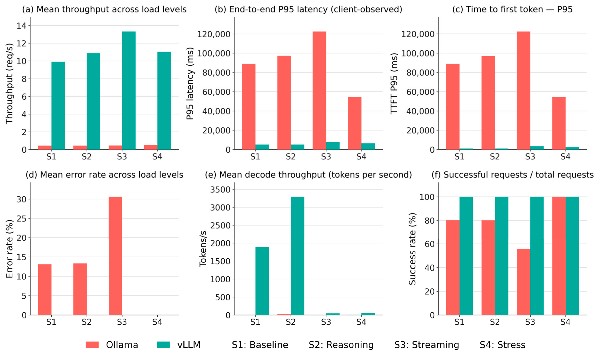

**图 11.** Ollama 与 vLLM 在全部四个测试场景下的跨场景性能比较：(a) 平均吞吐、(b) 端到端 P95 延迟、(c) P95 TTFT、(d) 平均错误率、(e) 平均解码吞吐、(f) 成功率（成功/总请求数）。

图 11b、c 展示延迟行为。Ollama 的 P95 延迟从 54.5 s（压力）到 122.5 s（流式），而 vLLM 在所有场景保持在 5.0–7.9 s。TTFT P95 差距更大：Ollama 在 54–122 s 产生首个 token，vLLM 在 0.5–3.5 s，优势 20–75 倍。

图 11d 展示平均错误率。vLLM 在所有场景保持 0% 错误率，四个场景共完成全部 99,802 个被评估请求。Ollama 的错误率从低压力测试并发时的 0% 到流式时的 30.06%，说明其错误与工作负载相关，在长连接的多轮流式下恶化。图 11e 给出平均解码吞吐：vLLM 基线达 1886 tok/s、推理达 3292 tok/s、流式 42 tok/s，而 Ollama 在所有场景低于 30 tok/s，基线与流式低于 2 tok/s。推理场景为 vLLM 带来最高解码吞吐，反映对长输出任务的有效批处理。图 11f 报告成功率：vLLM 四个场景均达 100%，而 Ollama 的可靠性不一——基线与推理约 80%，流式 56%，压力测试 100%（因为压力测试是在 Ollama 约 10 用户的"有效上限"而非其失败点上运行）。

图 12a 比较启发式质量代理分数。在两框架都产生了足够可评分输出的场景（3 和 4）中，Ollama 与 vLLM 相近，vLLM 略优（连贯性 0.79 对 0.75，响应质量 0.65 对 0.63）。场景 2 中，Ollama 因负载下响应截断而无可评分的推理输出，vLLM 的推理质量分数为 0.47。因此，两框架的差距主要来自吞吐、延迟与可靠性，而非已完成请求的输出质量。

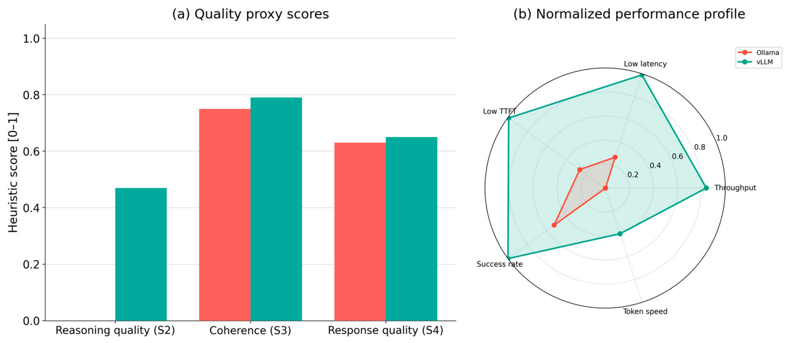

**图 12.** (a) Ollama 与 vLLM 跨场景的启发式质量代理分数（S2 为推理质量、S3 为响应连贯性、S4 为响应质量）；(b) 两框架的归一化性能画像（跨场景 min–max 缩放）。两图中红色为 Ollama，青色为 vLLM。

图 12b 呈现两框架归一化性能画像的雷达图。如图所示，vLLM 在每条轴上都达到或接近上限，而 Ollama 在所有轴上都靠近中心。我们观察到 vLLM 并未以牺牲某一维度换取另一维度，而是在吞吐、延迟、响应性、可靠性和 token 速率上保持均衡优势。

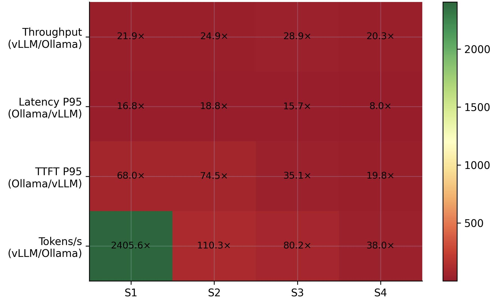

**图 13.** vLLM 跨场景、跨指标的优势比热力图：吞吐、P95 延迟、P95 TTFT 与解码吞吐。

图 13 呈现 vLLM 优势比热力图。吞吐优势跨场景为 20.3–28.9 倍，P95 延迟优势 8.0–18.8 倍，P95 TTFT 优势 19.8–74.5 倍，解码吞吐优势从 38 倍到超过 2400 倍（场景 1 中，Ollama 的 token 速率低于 1 tok/s 而 vLLM 超过 1800 tok/s）。最小比值出现在场景 4，因为 Ollama 是在其可用范围内（而非压力点）运行，比较被压缩到 Ollama 仍能工作的唯一区间。因此，vLLM 不仅平均更快，尾延迟也更可预测。

综合来看，这些结果表明，在所测工作负载下，vLLM 对高并发 LLM 服务更具可扩展性、资源效率更高、可靠性更强：四个场景中吞吐高出 20–29 倍、延迟低 8–19 倍。Ollama 部署更简单，且在已完成请求上输出质量相近，但在超出轻量设置的并发负载下无法保持吞吐、稳定性与延迟。总体而言，从系统视角看，在测试范围内 vLLM 是生产级 LLM 服务更稳健、更可扩展的选择；而 Ollama 对并发服务并非主要需求的轻量、本地或开发者场景仍是实用选项。详细日志、原始输出、基准脚本和配置文件见补充仓库，以支持复现与结果核查。

## 5. 讨论

### 5.1. 哪个框架更适合哪些场景？

结果表明 vLLM 在全部四个场景中都提供了更好的可扩展性与可靠性，因此对具有并发服务、流式或高压力需求的生产系统是更好的选择。其 9.9–13.3 req/s 的跨场景吞吐以及在最多 100 用户下低于 10 s 的可预测延迟，为聊天机器人、客服助手和交互式推理智能体等实时系统提供了稳定体验；其在所有场景 100% 的成功率也适合请求可靠性至关重要的生产环境。

相比之下，Ollama 在并发负载下缺乏竞争力，但仍适用于轻量、本地或单用户部署。在测试硬件上其有效上限约为 10 用户，超过后吞吐停滞、错误上升。其简单的安装、GGUF 模型格式和低运维开销使其适合个人助手、开发者原型、边缘部署以及运维复杂度低的场景。已完成请求上的启发式质量分数（连贯性 0.74–0.76、响应质量 0.63）表明 Ollama 在完成请求上的输出质量与 vLLM 相近——其限制来自服务架构而非模型本身。因此，Ollama 适合小规模或离线使用，而 vLLM 更适合高并发服务。

### 5.2. 资源与性能的权衡

两框架将硬件转化为服务能力的方式不同。Ollama 的 CPU 占用略高（9–10% 对 vLLM 的 4–6%），但 GPU 占用更低（15–17% 对 35–69%）。这说明 Ollama 未充分利用 H100，而 vLLM 通过 continuous batching、PagedAttention 和 FP8 原生执行，在每 GPU 周期内完成多得多的推理工作。已有独立研究报道，Hopper 级 GPU 上的 FP8 生成在相近精度下相比 BF16 带来可观的解码吞吐增益 [41]，与我们观察到的 vLLM 更高 GPU 效率一致。该模式并非我们框架或硬件所特有：独立研究在对比 vLLM 与另一竞争者（Hugging Face TGI）、不同模型族（LLaMA-2）和不同硬件（A100）时，同样报告 vLLM 通过 continuous batching 与 PagedAttention 获得显著更高的吞吐与 GPU 利用率，而较弱框架在更低并发即饱和 [17]。这与我们相对 Ollama 的观察一致。最终，vLLM 在使用相近或更少 CPU 的情况下，实现 20–29 倍的吞吐与低 8–19 倍的 P95 延迟。

一个值得注意的点是耐久测试期间的内存增长。两个框架在 3600 s 窗口内都有增长（Ollama 约 5602 MB，vLLM 约 14,219 MB），但 vLLM 的更高增长发生在其处理约 33 倍请求量的同时。按每请求计算，vLLM 在耐久测试期间的内存占用低得多，符合其 FP8 KV cache 策略。不过，vLLM 的绝对增长在长期使用中仍应监控。这与先前关于持续高并发服务下内存压力与碎片化会损害可扩展性、因而需要动态调度与迁移技术的研究 [42] 相呼应。这一权衡说明框架选择应与硬件和工作负载匹配：资源有限但需求低的场景用 Ollama，具备足够 GPU 显存与监控、以性能为驱动的生产系统用 vLLM。

### 5.3. 对部署场景的启示

从部署视角看结论很清晰。vLLM 在最多 100 用户的并发负载下保持 100% 成功率与可预测延迟，是测试条件下高并发服务的有力选择。它支持自动扩缩、负载均衡和容错部署，这对大规模可靠性至关重要。其在 100 用户之后的退化表现为延迟渐增而非失败，为运维人员的容量规划提供了明确的预警信号。内存占用应加以监控以应对长期增长。

Ollama 在可扩展性与稳定性上的限制——尤其是流式 30.06% 的错误率、基线与推理在 100 用户时 13–13.3% 的错误率——使其只能用于轻量或单用户场景。其简单性、GGUF 模型格式和本地优先设计，在易集成和开发者可及性比原始性能更重要的场合（如端侧推理、开发者原型或资源受限环境）仍有价值。最终，Ollama 与 vLLM 之间的选择取决于目标环境：高吞吐、延迟敏感且有并发用户的服务选 vLLM；轻量、资源受限或边缘环境且并发服务非主要需求的场景选 Ollama。

### 5.4. 性能退化的诊断分析

我们观察到，Ollama 在并发负载下的严重退化似乎源于内部队列饱和、有限的并行请求处理能力，以及推理层缺乏 continuous batching。其有效并发上限（压力测试中 10 用户）接近其设定的并行槽数，说明瓶颈是结构性的，而非硬件限制。在评估推理服务系统时，跨框架对齐此类并行度配置是公认的基线公平性问题 [43]。当并发超过该上限后，请求队列迅速填满，响应时间由队列等待主导，超时失败出现在基线与推理的 100 用户（39–40% 错误率）以及流式的 150 段对话（61% 错误率）。

相比之下，vLLM 在相同负载下保持了稳定调度与 continuous batching，所有级别成功率 100%。这有力说明批处理策略、KV cache 管理与请求调度是可扩展推理的主导因素，与迭代级调度 [19] 和分块预填充调度 [20] 的先前工作一致。Ollama 高得多的 TTFT（各场景 P95 为 54–122 s，vLLM 为 0.5–3.5 s）表明请求在 token 生成开始前经历了漫长等待。由于我们从客户端测量延迟，这些值包含队列积压与串行化推理，而不仅是模型计算时间。

Ollama 的退化遵循结构性过载模式，而非突然失败。随着并发上升，请求队列迅速填满，平均完成时间急剧上升（基线中从 10 用户时的 21 s 到 100 用户时的 100 s），部分请求开始超时。然而吞吐在所有级别都停滞在约 0.45 req/s，表明该框架在并行槽上限之外无法把额外负载转化为服务能力。

### 5.5. 局限性

本研究有若干需要留意的局限。第一，我们在单一硬件配置（单张 NVIDIA H100 80 GB）上使用单一模型族（Qwen3-4B），结果可能无法直接推广到其他模型架构、参数规模、量化格式或硬件。尤其 vLLM 的 FP8 原生路径仅在 Hopper 级及更新的 GPU 上可用；在较旧硬件上 vLLM 将回退到 GPTQ 或 FP16 执行，差距可能缩小。Ollama 的相对性能在其 GGUF 路径更具竞争力的硬件上也可能不同。

第二，我们从五个公开 Hugging Face 数据集（TriviaQA、GSM8K、HumanEval、HotpotQA、MT-Bench）在受控并发下构造场景，而非完全混合的真实流量。场景覆盖问答、多步推理、流式对话与压力负载，但真实系统可能具有比我们所捕获的更复杂的请求组合、更多样的工作负载以及多租户行为。

第三，若干质量指标（推理准确率、响应连贯性、响应质量与上下文保持）使用轻量启发式方法，而非人工标注、基于嵌入的度量（如 BERTScore [44]）或 LLM-as-judge 评估。Ollama 在场景 2 中 0.00 的准确率来自超时导致的截断与启发式评分的局限，而非纯粹的错误答案。因此该指标应视为负载下已完成输出质量的代理，而非精确的质量测量。

第四，测量工具未分别对服务端排队等待时间与纯推理时间插桩。所有延迟与 TTFT 值均为包含网络开销、排队、prefill 与 decode 的客户端观测综合值。这保证了两框架的一致性，但限制了延迟归因的精细程度；要完全区分过载下的排队与推理，需要更细的内部追踪。

最后，我们聚焦于单节点、单 GPU 部署，未研究分布式推理、多节点扩展、能效或成本–性能权衡。耐久内存增长以资源监控器的累计读数报告，并非稳态泄漏速率；确认长期稳定性需要更长的多日测试。未来工作应扩展到更广泛的设置、更大的模型和更长的耐久窗口，以检验这些发现的普适性。

## 6. 结论与未来工作

本文在四个场景（基线性能、复杂推理、流式与压力测试）下对 Ollama 与 vLLM 进行了系统基准测试。我们在单张 NVIDIA H100 80 GB GPU 上，使用相同的 Qwen3-4B 模型权重、相同的采样参数以及来自五个公开基准数据集（TriviaQA、GSM8K、HumanEval、HotpotQA、MT-Bench）的确定性子样本构建比较，确保差异仅来自两框架的内部设计。

实验表明，vLLM 在并发负载下提供更高吞吐（各场景高出 20–29 倍）、显著更低的延迟（P95 延迟低 8–19 倍）和近乎完美的可靠性（所有场景 100% 成功率）。它在约 100 用户前保持稳定，200 用户进入退化区间时仍完成所有请求。其在 Hopper 硬件上的 FP8 原生执行，结合 continuous batching 与基于 PagedAttention 的 KV cache 管理，实现了基线超过 1800 token/s、推理超过 3200 token/s 的解码吞吐。

相比之下，Ollama 在测试硬件上于约 10 用户处触及结构性并发上限，吞吐无论并发多少都停滞在 0.45 req/s。超过该上限后，队列饱和导致请求超时，从基线的 13% 到流式的 30% 以上。我们发现 Ollama 已完成请求上的启发式质量分数（连贯性 0.74–0.76、响应质量 0.63）接近 vLLM，说明差距主要来自服务架构而非生成质量。

耐久测试期间，两框架在 3600 s 窗口内均表现出显著的资源增长（Ollama 约 5.6 GB，vLLM 约 14.2 GB），尽管 vLLM 在同一窗口处理了约 33 倍的请求。按每请求计算，vLLM 的内存占用因此低得多，但绝对增长在长期使用中仍应监控。

除正面比较外，本工作的贡献还包括统一的四场景流水线（基线、推理、流式与压力测试）和开放的基准测试框架，使他人可在其他模型、框架和硬件上复现同样的比较。该流水线提供基于 Hugging Face commit SHA 的确定性数据集锁定、结构化环境日志、统一的流式 HTTP 测量，以及面向论文级表格与图表的模块化后处理。通过这项工作，我们强调 vLLM 是 Hopper 级硬件上并发负载下可扩展 LLM 推理的更稳健选择，而 Ollama 对轻量、本地或开发者部署仍然有用。

该方向仍有未来工作空间。特别是，比较可扩展到更大模型和多节点部署；耐久测试中观测到的内存增长可通过更长时间的运行加以研究以确认长期稳定性。另一个有用方向是加入能耗与成本–性能分析：本研究只测量了性能与资源占用，未来研究可补充每瓦 token 数、每请求能耗和每请求成本等指标，为部署决策提供更完整的依据。最后，本工作负载是受控的、分离为独立场景的；真实系统通常同时服务混合且突发的多类型流量以及多租户使用。未来工作可在更能反映生产流量的混合真实负载下测试两框架。

---

## 作者贡献

概念化：B.A.、Y.E.D.；方法：B.A.；软件：B.A.、Y.E.D.；验证：B.A.；形式分析：B.A.、Y.E.D.；调查：Y.E.D.；资源：B.A.；数据管理：B.A.；撰写——初稿：B.A.；撰写——审阅与编辑：B.A.、Y.E.D.；可视化：Y.E.D.；指导：B.A.；项目管理：B.A.。所有作者均已阅读并同意稿件发表版本。

**资助**：本研究无外部资助。
**伦理审查声明**：不适用。
**知情同意声明**：不适用。
**数据可用性声明**：本研究所用的全部实验脚本、提示词集合、Docker 配置、数据集版本锁定和测量工具已在 GitHub 公开：https://github.com/demirdagyunus/serving-compare-tests（访问日期 2026-04-17）。聚合结果已在文中报告。更多疑问请联系通讯作者。
**致谢**：稿件准备期间，作者使用 Claude Opus 4.7（Anthropic）进行语言编辑、校对和图形摘要制作。作者已审阅并编辑输出内容，并对本文内容承担全部责任。
**利益冲突**：作者声明无利益冲突。

## 参考文献

> 【译注】参考文献按惯例保留英文原文，共 44 条，详见原文 PDF 第 28–30 页。核心条目包括：
>
> 1. Pan, J.; Li, G. A survey of LLM inference systems. arXiv 2025, arXiv:2506.21901.
> 2. Zhou, Z. et al. A survey on efficient inference for large language models. arXiv 2024, arXiv:2404.14294.
> 3. Kwon, W. et al. Efficient memory management for large language model serving with PagedAttention. SOSP '23, pp. 611–626.
> 4. Hu, E.J. et al. LoRA: Low-rank adaptation of large language models. ICLR 2022.
> 5. Xu, X. et al. A survey on knowledge distillation of large language models. arXiv 2024, arXiv:2402.13116.
> 6. Dettmers, T. et al. QLoRA: Efficient finetuning of quantized LLMs. NeurIPS 2023, 36, 10088–10115.
> 7. Zhong, Y. et al. DistServe: Disaggregating prefill and decoding for goodput-optimized large language model serving. OSDI '24.
> 8. Wolf, T. et al. Transformers: State-of-the-art natural language processing. EMNLP 2020, pp. 38–45.
> 9. Aminabadi, R.Y. et al. DeepSpeed-Inference: Enabling efficient inference of transformer models at unprecedented scale. SC22.
> 10. Zhou, Y.; Yang, K. Exploring TensorRT to improve real-time inference for deep learning. HPCC/DSS/SmartCity/DependSys 2022.
> 11. Ollama Contributors. Ollama: Local Large Language Models. https://github.com/ollama
> 12. Li, B. et al. LLM inference serving: Survey of recent advances and opportunities. IEEE HPEC 2024.
> 13. Oh, H. et al. ExeGPT: Constraint-aware resource scheduling for LLM inference. ASPLOS '24, Volume 2.
> 14. Dao, T. et al. FlashAttention: Fast and memory-efficient exact attention with IO-awareness. NeurIPS 2022, 35, 16344–16359.
> 15. Sheng, Y. et al. FlexGen: High-throughput generative inference of large language models with a single GPU. ICML 2023.
> 16. Lang, J.; Guo, Z.; Huang, S. A comprehensive study on quantization techniques for large language models. ICAIRC 2024.
> 17. Kolluru, S. Comparative analysis of large language model inference serving systems: A performance study of vLLM and HuggingFace TGI. arXiv 2025, arXiv:2511.17593.
> 18. Chitty-Venkata, K.T. et al. LLM-inference-bench: Inference benchmarking of large language models on AI accelerators. SC24-W.
> 19. Yu, G.I. et al. Orca: A distributed serving system for transformer-based generative models. OSDI '22.
> 20. Agrawal, A. et al. Taming throughput-latency tradeoff in LLM inference with Sarathi-Serve. OSDI '24.
> 21. Patel, P. et al. Splitwise: Efficient generative LLM inference using phase splitting. ISCA 2024.
> 22. Zheng, L. et al. SGLang: Efficient execution of structured language model programs. NeurIPS 2024, 37, 62557–62583.
> 23. Cai, T. et al. Medusa: Simple LLM inference acceleration framework with multiple decoding heads. arXiv 2024, arXiv:2401.10774.
> 24. Li, Y. et al. EAGLE: Speculative sampling requires rethinking feature uncertainty. arXiv 2024, arXiv:2401.15077.
> 25. Husom, E.J. et al. Sustainable LLM inference for edge AI: Evaluating quantized LLMs for energy efficiency, output accuracy, and inference latency. ACM Trans. Internet Things 2025, 6, 1–35.
> 26. Laskaridis, S. et al. Melting point: Mobile evaluation of language transformers. ACM MobiCom '24.
> 27. Stuhlmann, L. et al. Bench360: Benchmarking local LLM inference from 360°. arXiv 2025, arXiv:2511.16682.
> 28. Rajesh, V. et al. Production-grade local LLM inference on Apple Silicon: A comparative study of MLX, MLC-LLM, Ollama, llama.cpp, and PyTorch MPS. arXiv 2025, arXiv:2511.05502.
> 29. Yang, A. et al. Qwen3 technical report. arXiv 2025, arXiv:2505.09388.
> 30. ggml-org. llama.cpp: LLM Inference in C/C++. https://github.com/ggml-org/llama.cpp
> 31. Joshi, M. et al. TriviaQA: A large scale distantly supervised challenge dataset for reading comprehension. ACL 2017, pp. 1601–1611.
> 32. Cobbe, K. et al. Training verifiers to solve math word problems. arXiv 2021, arXiv:2110.14168.
> 33. Chen, M. et al. Evaluating large language models trained on code. arXiv 2021, arXiv:2107.03374.
> 34. Yang, Z. et al. HotpotQA: A dataset for diverse, explainable multi-hop question answering. EMNLP 2018, pp. 2369–2380.
> 35. Zheng, L. et al. Judging LLM-as-a-judge with MT-Bench and Chatbot Arena. NeurIPS 2023, 36, 46595–46623.
> 36. Dean, J.; Barroso, L.A. The tail at scale. Commun. ACM 2013, 56, 74–80.
> 37. Yan, Y. et al. A survey of mathematical reasoning in the era of multimodal large language model: Benchmark, method & challenges. Findings of ACL 2025.
> 38. Jiang, J. et al. A survey on large language models for code generation. ACM TOSEM 2026, 35, 1–72.
> 39. Mavi, V. et al. Multi-hop question answering. Found. Trends Inf. Retr. 2024, 17, 457–586.
> 40. Yi, Z. et al. A survey on recent advances in LLM-based multi-turn dialogue systems. ACM Comput. Surv. 2025, 58, 1–38.
> 41. NVIDIA. Llama-Nemotron: Efficient reasoning models. arXiv 2025, arXiv:2505.00949.
> 42. Sun, B. et al. Llumnix: Dynamic scheduling for large language model serving. OSDI '24.
> 43. Agrawal, A. et al. On evaluating performance of LLM inference serving systems. arXiv 2025, arXiv:2507.09019.
> 44. Zhang, T. et al. BERTScore: Evaluating text generation with BERT. arXiv 2019, arXiv:1904.09675.

**出版方声明**：所有出版物中包含的陈述、观点和数据仅为各作者与贡献者个人的观点和数据，不代表 MDPI 和/或编者的立场。MDPI 和/或编者对内容中提及的任何思想、方法、说明或做法可能对人身或财产造成的任何伤害不承担任何责任。
